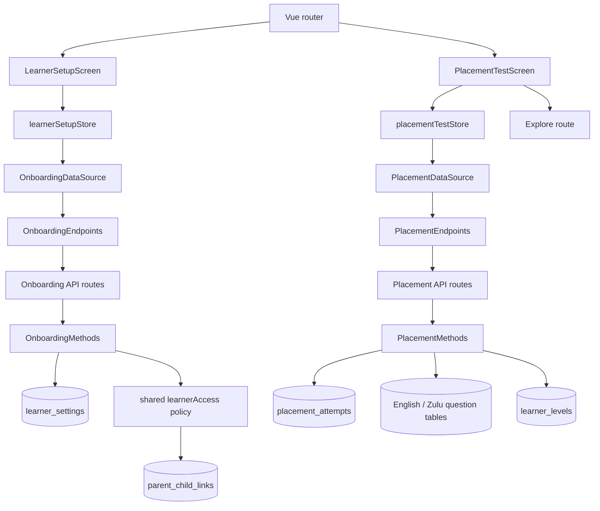
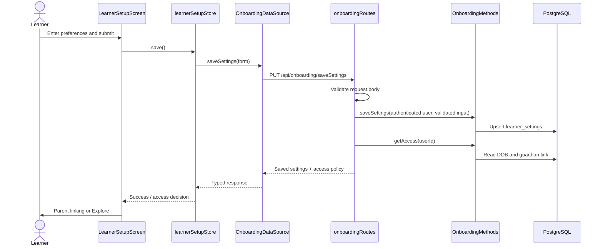

# Learner Setup and Placement Test

This guide explains how learner setup and placement work across the Vue frontend, Express API, PostgreSQL schema, and test suites. It follows the current implementation and names the files that own each part.

## At a glance

The setup flow collects the learner's target language, interface language, date of birth, and daily goal. The backend validates and persists those settings. The placement flow then serves a language-specific 30-question ladder, grades answers on the server, and records the assigned learner level. A learner can instead skip (Level 1) or quit (the active question's level).



## Learner setup

### Entry and screen behavior

The named `learnerSetup` route is declared in [frontend/src/router/index.ts](../../frontend/src/router/index.ts). It requires an authenticated learner. The router's `beforeEach` calls `authStore.restoreServerSession()` for protected routes and rejects users whose role is not listed in route metadata.

[LearnerSetupScreen.vue](../../frontend/src/features/onboarding_feature/presentation/screens/LearnerSetupScreen/LearnerSetupScreen.vue) is the form and navigation layer. It:

- Loads any saved preferences when mounted.
- Provides target-language, interface-language, date-of-birth, and daily-goal controls.
- Shows the interface-language control only for isiZulu learners; choosing English as the target resets interface copy to English.
- Sends a save through the store. On success, it routes blocked under-13 learners to parent linking and permitted learners to Explore.
- Watches the interface-language form value and updates the shared `vue-i18n` locale.

The persisted form state and request flags belong to [learnerSetupStore.ts](../../frontend/src/features/onboarding_feature/presentation/screens/LearnerSetupScreen/state/learnerSetupStore.ts). `load()` maps the API's snake_case row into the form's camelCase values. A 404 from `getSettings` means first-time setup and is not surfaced as an error. `save()` keeps the submitted form on failure and stores the returned settings and access policy on success. `checkAccess()` refreshes that policy when needed.

### Frontend API boundary

[OnboardingTypes.ts](../../frontend/src/features/onboarding_feature/models/OnboardingTypes.ts) defines:

- `OnboardingInput`: camelCase form fields sent by the browser.
- `OnboardingSettings`: snake_case fields returned from persistence.
- `LearnerAccess`: the server-evaluated age, parent-link, permission, and audience flags.

[onboardingEndpoints.ts](../../frontend/src/core/endpoints/feature_endpoints/onboardingEndpoints.ts) maps the client methods to `GET /api/onboarding/getSettings`, `PUT /api/onboarding/saveSettings`, and `GET /api/onboarding/getAccess`. [onboardingDataSource.ts](../../frontend/src/features/onboarding_feature/datasources/onboardingDataSource.ts) executes those endpoint definitions, parses typed responses, and converts transport exceptions to the common data-source response shape.

### Backend API and persistence

[onboardingRoutes.ts](../../backend/src/routes/api/routes.api/onboardingRoutes/onboardingRoutes.ts) restricts all three endpoints to the `learner` role. The save route validates the untrusted body before calling persistence, then recalculates access and returns both the saved row and access policy.

[onboardingType.ts](../../backend/src/routes/api/routes.api/onboardingRoutes/types/onboardingType.ts) defines the request/database response types and validates that:

- The body is an object.
- Target and interface languages are non-empty strings no longer than 80 characters.
- Date of birth is valid, from 1900 through today.
- Daily goal is an integer from 1 through 120.

[onboardingMethods.ts](../../backend/src/routes/api/routes.api/onboardingRoutes/methods/onboardingMethods.ts) owns SQL access to `learner_settings`. `saveSettings()` uses an upsert keyed by authenticated `user.id`, so a repeated save updates the existing row. `getSettings()` returns the date as `YYYY-MM-DD` text to avoid timezone date shifts.

Age and guardian policy is centralized in [backend/src/shared/learnerAccess.ts](../../backend/src/shared/learnerAccess.ts). It calculates age from the stored date of birth and checks `parent_child_links`. Under-13 learners are limited to the `child` audience and cannot access content until a parent link exists.

## Placement test

### Screen and store responsibilities

[PlacementTestScreen.vue](../../frontend/src/features/onboarding_feature/presentation/screens/PlacementTestScreen/PlacementTestScreen.vue) owns the visible phases:

1. **Intro:** explains the 30-question, six-level ladder and offers Start or Skip.
2. **Test:** renders one server-selected question, its answer controls, the question counter, current tier, and five-question tier progress.
3. **Results:** displays the server-assigned CEFR result and continues to Explore.

The free-text answer input is capped at 20 characters. Starting and answer submission enforce the server's access response; a 403 routes to parent linking. Skip persists the Level 1 assignment before routing to Explore with a notice flag. Quit closes the attempt at the current question's level and uses the same result screen as a completed or failed assessment.

[placementTestStore.ts](../../frontend/src/features/onboarding_feature/presentation/screens/PlacementTestScreen/state/placementTestStore.ts) is the reactive state machine for the attempt. Its getters calculate overall progress, the active proficiency level, next tier, and five-question tier progress. Its actions start, grade, skip, quit, select answers, and reset the attempt. The server remains authoritative for correctness and assigned level.

### Frontend API boundary

[PlacementTestTypes.ts](../../frontend/src/features/onboarding_feature/models/PlacementTestTypes.ts) defines question, option, result, attempt-start, answer-submit, skip, and quit response shapes. Correct answers are deliberately absent from client question types.

[placementEndpoints.ts](../../frontend/src/core/endpoints/feature_endpoints/placementEndpoints.ts) defines these requests:

- `POST /api/placement/startPlacement`
- `POST /api/placement/submitAnswer/:attemptId`
- `POST /api/placement/skipPlacement`
- `POST /api/placement/quitPlacement/:attemptId`

[PlacementTestDataSource.ts](../../frontend/src/features/onboarding_feature/datasources/PlacementTestDataSource.ts) calls those endpoints, parses their typed responses, and returns failures in the standard non-throwing response wrapper consumed by the store.

### Backend routes and rules

[placementRoutes.ts](../../backend/src/routes/api/routes.api/placementRoutes/placementRoutes.ts) registers the learner-only start, skip, answer, and quit routes. It also provides `GET /api/placement/getLearnerLevel` for the authenticated learner and an administrator-only downstream increment route. Answer bodies are validated by [placementType.ts](../../backend/src/routes/api/routes.api/placementRoutes/types/placementType.ts) before grading.

[placementMethods.ts](../../backend/src/routes/api/routes.api/placementRoutes/methods/placementMethods.ts) is the placement business and persistence owner. The large English and isiZulu fixture arrays contain 30 questions apiece, organized as six five-question tiers. The service:

- Resolves the learner's target language from setup and stores that language on the attempt.
- Creates an attempt row and returns its first question without `correct_id`.
- Grades answers server-side and verifies the submitted question is the attempt's current question. Replayed, out-of-order, cross-language, and stale concurrent requests are rejected.
- Advances the attempt on a correct answer; a wrong answer ends early and assigns the level earned before the wrong response.
- Completes a successful 30-question ladder at the highest earned level.
- On Quit, assigns the level belonging to the active unanswered question and does not increment score.
- On Skip, assigns Level 1 after applying the learner content-access gate.
- Reads and increments learner levels through the placement-owned methods. The increment is atomic and capped at Level 6.
- Loads questions from PostgreSQL, idempotently seeds missing canonical questions, and surfaces database errors instead of silently pretending the database query succeeded.

### How the ladder is persisted

Migrations are applied in numeric filename order by [backend/scripts/migrate.ts](../../backend/scripts/migrate.ts), with applied filenames recorded in `schema_migrations`.

- [200_learner_settings.sql](../../backend/migrations/200_learner_settings.sql) creates the learner preference table.
- [201_learner_settings_user_fk.sql](../../backend/migrations/201_learner_settings_user_fk.sql) links preferences to accounts.
- [202_placement.sql](../../backend/migrations/202_placement.sql) creates `learner_levels`, `placement_attempts`, and the original English `placement_questions` table/seed.
- [205_placement_attempt_target_language.sql](../../backend/migrations/205_placement_attempt_target_language.sql) records the language snapshot used by each attempt.
- [206_placement_question_ladder_schema.sql](../../backend/migrations/206_placement_question_ladder_schema.sql) adds question tier metadata and creates `zulu_placement_questions`.
- [207_placement_question_level_backfill.sql](../../backend/migrations/207_placement_question_level_backfill.sql) derives tiers for existing English seed rows from `order_index`.

**Two different level tables:** `learner_levels` is the per-learner proficiency assignment owned by placement/onboarding. `levels` in [400_taxonomy.sql](../../backend/migrations/400_taxonomy.sql) describes levels that content can be tagged with. The tables are related by level number but serve different ownership and query purposes.

### Level result labels

The numeric proficiency-to-CEFR result mapping is in `formatPlacementResult()` in [placementMethods.ts](../../backend/src/routes/api/routes.api/placementRoutes/methods/placementMethods.ts): Levels 1–6 map to A1, A2, B1, B2, C1, and C2. Display names are localized in [frontend/src/i18n.ts](../../frontend/src/i18n.ts) as English and isiZulu placement strings. Individual questions carry a `level_number`; where a row lacks one, the service derives it from its zero-based `order_index` in five-question bands.

## End-to-end flows

### Save setup



### Start, answer, skip, or quit placement

```mermaid
sequenceDiagram
    actor Learner
    participant Screen as PlacementTestScreen
    participant Store as placementTestStore
    participant DS as PlacementDataSource
    participant API as placementRoutes
    participant Methods as PlacementMethods
    participant DB as PostgreSQL
    Learner->>Screen: Start test
    Screen->>Store: startTest()
    Store->>DS: startPlacement()
    DS->>API: POST /api/placement/startPlacement
    API->>Methods: startPlacement(userId)
    Methods->>DB: Check access, resolve language, load/seed questions, insert attempt
    Methods-->>Screen: attemptId + first public question + totalQuestions
    loop While the learner answers correctly
      Learner->>Screen: Select/type answer
      Screen->>Store: submitAnswer()
      Store->>DS: submitAnswer(attemptId, questionId, answer)
      DS->>API: POST /api/placement/submitAnswer/:attemptId
      API->>Methods: Validate, verify current question, grade
      Methods->>DB: Compare key; conditionally advance attempt
      Methods-->>Screen: Next question or terminal result
    end
    alt Skip from intro
      Learner->>Screen: Skip placement
      Screen->>Store: skipPlacement()
      Store->>DS: skipPlacement()
      DS->>API: POST /api/placement/skipPlacement
      API->>Methods: Access check + assign Level 1
      Methods->>DB: Save learner level
      Screen->>Learner: Explore with Level 1 notice
    else Quit during test
      Learner->>Screen: Quit test
      Screen->>Store: quitTest()
      Store->>DS: quitPlacement(attemptId)
      DS->>API: POST /api/placement/quitPlacement/:attemptId
      API->>Methods: Assign active question's level
      Methods->>DB: Atomically complete attempt + save learner level
      Screen->>Learner: Placement result panel
    end
```

  ## Responsibility and LIN links

  The links below identify the main implementation and verification files for each responsibility. The task statuses in the LIN table are reproduced from the supplied checklist.

  ### Responsibility map

  - **Database and schema management:** [migrate.ts](../../backend/scripts/migrate.ts) applies versioned migrations; [202_placement.sql](../../backend/migrations/202_placement.sql), [205_placement_attempt_target_language.sql](../../backend/migrations/205_placement_attempt_target_language.sql), [206_placement_question_ladder_schema.sql](../../backend/migrations/206_placement_question_ladder_schema.sql), and [207_placement_question_level_backfill.sql](../../backend/migrations/207_placement_question_level_backfill.sql) define learner levels, attempts, language-specific question tables, and tier metadata. The setup schema is in [200_learner_settings.sql](../../backend/migrations/200_learner_settings.sql) and [201_learner_settings_user_fk.sql](../../backend/migrations/201_learner_settings_user_fk.sql).
  - **Level access control and exclusive writes:** [placementRoutes.ts](../../backend/src/routes/api/routes.api/placementRoutes/placementRoutes.ts) exposes learner-level read and administrator increment routes; [placementMethods.ts](../../backend/src/routes/api/routes.api/placementRoutes/methods/placementMethods.ts) owns writes, increments, and bounds; [learnerAccess.ts](../../backend/src/shared/learnerAccess.ts) enforces the shared access policy. Coverage is in [placementMethods.test.ts](../../backend/test/unit/placementMethods.test.ts), [placementRoutes.test.ts](../../backend/test/unit/placementRoutes.test.ts), and [learnerAccess.test.ts](../../backend/test/unit/learnerAccess.test.ts).
  - **Learner setup view:** [LearnerSetupScreen.vue](../../frontend/src/features/onboarding_feature/presentation/screens/LearnerSetupScreen/LearnerSetupScreen.vue), [learnerSetupStore.ts](../../frontend/src/features/onboarding_feature/presentation/screens/LearnerSetupScreen/state/learnerSetupStore.ts), [OnboardingTypes.ts](../../frontend/src/features/onboarding_feature/models/OnboardingTypes.ts), and [onboardingDataSource.ts](../../frontend/src/features/onboarding_feature/datasources/onboardingDataSource.ts). Frontend coverage: [learnerSetupStore.spec.ts](../../frontend/src/features/onboarding_feature/presentation/screens/LearnerSetupScreen/state/__tests__/learnerSetupStore.spec.ts) and [onboardingDataSource.spec.ts](../../frontend/src/features/onboarding_feature/datasources/__tests__/onboardingDataSource.spec.ts).
  - **Age detection and safety:** [learnerAccess.ts](../../backend/src/shared/learnerAccess.ts) calculates age and parent-link eligibility; [onboardingMethods.ts](../../backend/src/routes/api/routes.api/onboardingRoutes/methods/onboardingMethods.ts) loads the relevant settings and link state; [ParentLinkScreen.vue](../../frontend/src/features/auth_feature/presentation/screens/ParentLinkScreen/ParentLinkScreen.vue) is the frontend destination for blocked learners. Coverage: [learnerAccess.test.ts](../../backend/test/unit/learnerAccess.test.ts), [onboardingRoutes.test.ts](../../backend/test/unit/onboardingRoutes.test.ts), and [onboardingRoutes.test.ts](../../backend/test/integration/onboardingRoutes.test.ts).
  - **Placement engine:** [placementMethods.ts](../../backend/src/routes/api/routes.api/placementRoutes/methods/placementMethods.ts) contains the language-specific question banks, grading ladder, scoring, and level assignment. Route and method coverage: [placementMethods.test.ts](../../backend/test/unit/placementMethods.test.ts), [placementRoutes.test.ts](../../backend/test/unit/placementRoutes.test.ts), and [placementRoutes.test.ts](../../backend/test/integration/placementRoutes.test.ts).
  - **Placement test and result screens:** [PlacementTestScreen.vue](../../frontend/src/features/onboarding_feature/presentation/screens/PlacementTestScreen/PlacementTestScreen.vue), [placementTestStore.ts](../../frontend/src/features/onboarding_feature/presentation/screens/PlacementTestScreen/state/placementTestStore.ts), and [PlacementTestTypes.ts](../../frontend/src/features/onboarding_feature/models/PlacementTestTypes.ts). Coverage: [PlacementTestScreen.spec.ts](../../frontend/src/features/onboarding_feature/presentation/screens/PlacementTestScreen/__tests__/PlacementTestScreen.spec.ts) and [placementTestStore.spec.ts](../../frontend/src/features/onboarding_feature/presentation/screens/PlacementTestScreen/state/__tests__/placementTestStore.spec.ts).
  - **Backend API development:** onboarding contracts/routes are in [onboardingRoutes.ts](../../backend/src/routes/api/routes.api/onboardingRoutes/onboardingRoutes.ts), [onboardingType.ts](../../backend/src/routes/api/routes.api/onboardingRoutes/types/onboardingType.ts), and [onboardingMethods.ts](../../backend/src/routes/api/routes.api/onboardingRoutes/methods/onboardingMethods.ts). Placement contracts/routes are in [placementRoutes.ts](../../backend/src/routes/api/routes.api/placementRoutes/placementRoutes.ts), [placementType.ts](../../backend/src/routes/api/routes.api/placementRoutes/types/placementType.ts), and [placementMethods.ts](../../backend/src/routes/api/routes.api/placementRoutes/methods/placementMethods.ts). Client endpoint definitions are [onboardingEndpoints.ts](../../frontend/src/core/endpoints/feature_endpoints/onboardingEndpoints.ts) and [placementEndpoints.ts](../../frontend/src/core/endpoints/feature_endpoints/placementEndpoints.ts).

  ### LIN completion checklist

  | Task | Implementation and test files | Completed? | Tested? | Commented? |
  |---|---|---:|---:|---:|
  | **LIN-69 Placement Ladder engine** | [placementMethods.ts](../../backend/src/routes/api/routes.api/placementRoutes/methods/placementMethods.ts); [placementMethods.test.ts](../../backend/test/unit/placementMethods.test.ts); [placementRoutes.test.ts](../../backend/test/integration/placementRoutes.test.ts) | Yes | Yes | Yes |
  | **LIN-70 Placement test screens** | [PlacementTestScreen.vue](../../frontend/src/features/onboarding_feature/presentation/screens/PlacementTestScreen/PlacementTestScreen.vue); [placementTestStore.ts](../../frontend/src/features/onboarding_feature/presentation/screens/PlacementTestScreen/state/placementTestStore.ts); [PlacementTestScreen.spec.ts](../../frontend/src/features/onboarding_feature/presentation/screens/PlacementTestScreen/__tests__/PlacementTestScreen.spec.ts); [placementTestStore.spec.ts](../../frontend/src/features/onboarding_feature/presentation/screens/PlacementTestScreen/state/__tests__/placementTestStore.spec.ts) | Yes | Yes | Yes |
  | **LIN-71 Placement result writes starting level to database** | [placementMethods.ts](../../backend/src/routes/api/routes.api/placementRoutes/methods/placementMethods.ts); [placementRoutes.ts](../../backend/src/routes/api/routes.api/placementRoutes/placementRoutes.ts); [202_placement.sql](../../backend/migrations/202_placement.sql); [placementMethods.test.ts](../../backend/test/unit/placementMethods.test.ts) | Yes | Yes | Yes |
  | **LIN-72 Skipping placement assigns Level 1** | [PlacementTestScreen.vue](../../frontend/src/features/onboarding_feature/presentation/screens/PlacementTestScreen/PlacementTestScreen.vue); [placementTestStore.ts](../../frontend/src/features/onboarding_feature/presentation/screens/PlacementTestScreen/state/placementTestStore.ts); [placementMethods.ts](../../backend/src/routes/api/routes.api/placementRoutes/methods/placementMethods.ts); [placementRoutes.test.ts](../../backend/test/unit/placementRoutes.test.ts) | Yes | Yes | Yes |
  | **LIN-76 PostgreSQL schema for placement and learner levels** | [202_placement.sql](../../backend/migrations/202_placement.sql); [205_placement_attempt_target_language.sql](../../backend/migrations/205_placement_attempt_target_language.sql); [206_placement_question_ladder_schema.sql](../../backend/migrations/206_placement_question_ladder_schema.sql); [207_placement_question_level_backfill.sql](../../backend/migrations/207_placement_question_level_backfill.sql); [migrate.ts](../../backend/scripts/migrate.ts) | Yes | Yes | Yes |
  | **LIN-86 Alternate-language test screens** | [PlacementTestScreen.vue](../../frontend/src/features/onboarding_feature/presentation/screens/PlacementTestScreen/PlacementTestScreen.vue); [PlacementTestTypes.ts](../../frontend/src/features/onboarding_feature/models/PlacementTestTypes.ts); [placementMethods.ts](../../backend/src/routes/api/routes.api/placementRoutes/methods/placementMethods.ts); [206_placement_question_ladder_schema.sql](../../backend/migrations/206_placement_question_ladder_schema.sql); [placementTestStore.spec.ts](../../frontend/src/features/onboarding_feature/presentation/screens/PlacementTestScreen/state/__tests__/placementTestStore.spec.ts) | Yes | Yes | Yes |
  | **LIN-87 English and alternate-language question banks and routing** | [placementMethods.ts](../../backend/src/routes/api/routes.api/placementRoutes/methods/placementMethods.ts); [placementRoutes.ts](../../backend/src/routes/api/routes.api/placementRoutes/placementRoutes.ts); [205_placement_attempt_target_language.sql](../../backend/migrations/205_placement_attempt_target_language.sql); [206_placement_question_ladder_schema.sql](../../backend/migrations/206_placement_question_ladder_schema.sql); [207_placement_question_level_backfill.sql](../../backend/migrations/207_placement_question_level_backfill.sql); [placementMethods.test.ts](../../backend/test/unit/placementMethods.test.ts) | Yes | Yes | Yes |

## Tests

- Frontend learner-setup state: [learnerSetupStore.spec.ts](../../frontend/src/features/onboarding_feature/presentation/screens/LearnerSetupScreen/state/__tests__/learnerSetupStore.spec.ts)
- Frontend setup API mapping: [onboardingDataSource.spec.ts](../../frontend/src/features/onboarding_feature/datasources/__tests__/onboardingDataSource.spec.ts)
- Interface-language precedence: [i18nLocale.spec.ts](../../frontend/src/features/onboarding_feature/functions/__tests__/i18nLocale.spec.ts)
- Placement screen flows: [PlacementTestScreen.spec.ts](../../frontend/src/features/onboarding_feature/presentation/screens/PlacementTestScreen/__tests__/PlacementTestScreen.spec.ts)
- Placement store transitions: [placementTestStore.spec.ts](../../frontend/src/features/onboarding_feature/presentation/screens/PlacementTestScreen/state/__tests__/placementTestStore.spec.ts)
- Placement API mapping: [placementTestDataSource.spec.ts](../../frontend/src/features/onboarding_feature/datasources/__tests__/placementTestDataSource.spec.ts)
- Backend setup validation/persistence: [onboarding_setup.test.ts](../../backend/test/unit/onboarding_setup.test.ts)
- Backend setup route authorization: [onboardingRoutes.test.ts](../../backend/test/unit/onboardingRoutes.test.ts)
- Backend placement grading and persistence: [placementMethods.test.ts](../../backend/test/unit/placementMethods.test.ts)
- Backend placement route authorization/contracts: [placementRoutes.test.ts](../../backend/test/unit/placementRoutes.test.ts)
- Real database placement and onboarding flows: [placementRoutes.test.ts](../../backend/test/integration/placementRoutes.test.ts) and [onboardingRoutes.test.ts](../../backend/test/integration/onboardingRoutes.test.ts)
