# Content builder GUI tests

Manual test script for the content builder screens: building a draft, text, media and question blocks, pages, saving, reopening, previewing, submitting and the read-only lock. Each test lists what to do, what you should see, and what was actually seen on the last run, so anyone in the group can repeat it and compare. The screenshots were taken from the running app during that run. The run was driven through Chrome's DevTools protocol with real mouse and keyboard events; headless Chrome draws neither the drag image nor native dialogs, so those are not in the screenshots.

**Last run:** 27 September 2026, Chrome 153 at 1280 × 860. CB-GUI-01 to 20 were first run on branch `content_to_main` at `4606bae`. After the follow-up fixes (on `main` at `deaf1b5`), CB-GUI-21 and 22 were run again in full, and CB-GUI-10, 11, 12, 13, 14, 15 and 19 were run again as a regression check. Every observed result below was checked on the page during those runs. **21 pass and 1 known gap** out of 22 tests. CB-GUI-22 step 5 (audience) is a **known limitation (team decision)**. Everything open is listed under [Findings](#findings).

## Before you start

Start the database, create the tables and load the seed accounts and demo content:

```bash
cd backend && docker compose up -d && npm run migrate && npm run seed:staff && npm run seed:demo && npm run dev
```

```bash
cd frontend && npm run dev
```

1. Open http://localhost:5173/sign-in and sign in as the **author** account that `backend/scripts/seedStaff.ts` creates. Its email and password are printed by `npm run seed:staff`; they are not repeated here.
2. Click **Content builder** in the top bar, or open http://localhost:5173/content-builder.

Notes for every test:

- Reloading `/content-builder` starts a new, empty draft, so each test begins with a reload unless it says it follows another test. Reloading `/content-builder/<id>` opens that saved draft instead.
- The address names the draft on screen. Once a draft has been saved (or submitted) the address is `/content-builder/<id>`, and deleting it goes back to `/content-builder`. **+ New content** on the Author dashboard (`/content-builder?new=1`) always starts an empty draft. Plain `/content-builder` reached through a link, such as **Content builder** in the top bar or **Back to builder**, carries on with the draft in progress.
- Tests that mention the Network tab need the browser's developer tools open. `<id>` means the content id in the URL of the first save or submit request (for example `PUT /api/content/editContent/9` means `<id>` is 9).
- The audio tests use the demo clip `docs/MO/test1.mp3` (about 5 seconds) and, for an invalid file, `docs/MO/test3.mp3` (5.1 MB) and `docs/MO/MO GUI Tests.pdf`. The transcripts typed in the tests are example isiZulu phrases; the builder does not check that they match what the clip says.
- API checks use the browser console, because every content route needs the signed-in author's token. Paste this once, then use `api(...)` as the steps say:

  ```js
  const api = (path, init = {}) => fetch('http://localhost:4000/api/content/' + path, { ...init,
    headers: { 'Content-Type': 'application/json', Authorization: 'Bearer ' + localStorage.getItem('lingolearn_auth_token') } })
    .then(async r => [r.status, await r.json()]);
  ```

- The last run used backend port 4001 and frontend port 5188 because other servers were already on the defaults (`VITE_API_PORT=4001` in `frontend/.env.local`). Nothing else changes with the port.

## Summary

| ID | Test | Result |
|---|---|---|
| [CB-GUI-01](#cb-gui-01) | Open a new draft | Pass |
| [CB-GUI-02](#cb-gui-02) | Add and fill in a text block | Pass |
| [CB-GUI-03](#cb-gui-03) | Switch a block between editing and viewing | Pass |
| [CB-GUI-04](#cb-gui-04) | Give a new block its type | Pass |
| [CB-GUI-05](#cb-gui-05) | Image block with a placeholder file | Pass |
| [CB-GUI-06](#cb-gui-06) | Audio block with an uploaded clip | Pass |
| [CB-GUI-07](#cb-gui-07) | Delete a block | Pass |
| [CB-GUI-08](#cb-gui-08) | Reorder blocks by dragging | Pass |
| [CB-GUI-09](#cb-gui-09) | Add, switch and delete pages | Pass |
| [CB-GUI-10](#cb-gui-10) | Save a draft and open it again | Pass |
| [CB-GUI-11](#cb-gui-11) | Submit screen blocks an incomplete draft | Pass |
| [CB-GUI-12](#cb-gui-12) | Fix the draft and fill in title, language, audience, level and tags | Pass |
| [CB-GUI-13](#cb-gui-13) | Submit locks the draft | Pass |
| [CB-GUI-14](#cb-gui-14) | Delete a draft | Pass |
| [CB-GUI-15](#cb-gui-15) | Saving while the server is down | Pass |
| [CB-GUI-16](#cb-gui-16) | Multiple choice block | Pass |
| [CB-GUI-17](#cb-gui-17) | Fill in the blank block | Pass |
| [CB-GUI-18](#cb-gui-18) | Listen and choose block | Pass |
| [CB-GUI-19](#cb-gui-19) | Submit checklist with questions | Pass |
| [CB-GUI-20](#cb-gui-20) | Author preview | **Known gap** |
| [CB-GUI-21](#cb-gui-21) | Content size limit | Pass (re-run after fix) |
| [CB-GUI-22](#cb-gui-22) | Reopened drafts and starting new ones | Pass (re-run after fix); step 5 **Known limitation (team decision)** |

## CB-GUI-01

### Open a new draft

**Checks:** A new draft opens empty, saved and ready for its first block.

**Before:** Backend and frontend running, signed in as the seeded author.

| Step | Do this | Expected result | Observed result |
|---|---|---|---|
| 1 | Open `/content-builder`. | The header shows an empty title field with the placeholder **Untitled draft**, a **Draft** chip and **All changes saved**. **Preview** and **Saved** are disabled; **Delete draft** and **Submit for review** are enabled. The Pages column has **Page 1** selected with no delete ×. The canvas reads **Page 1 · blocks** and **0 blocks**. Under **Blocks**, **Text**, **Image**, **Audio**, **Multiple Choice**, **Fill in the Blank** and **Listen and Choose** are all enabled. | Pass. As expected. Below the six block buttons there is also an older **Questions** heading with three disabled buttons (**Multiple choice**, **Fill in the blank**, **Listen & choose**) and the note *Available once the content is tagged as a test.* These are left over: the same three types are enabled above (see [Findings](#findings)). |

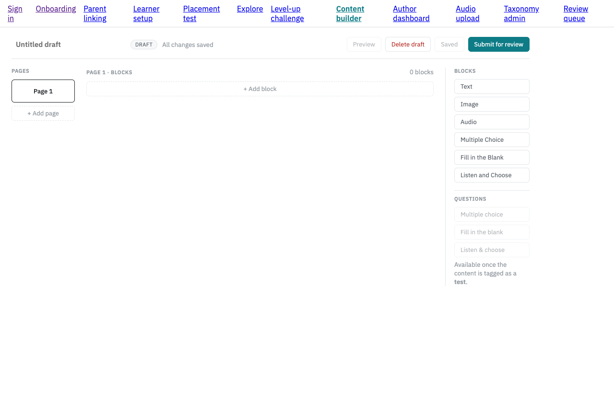

*A new draft: one empty page, nothing to save.*

## CB-GUI-02

### Add and fill in a text block

**Checks:** A text block can be added from the palette and edited in place.

**Before:** CB-GUI-01 done: a new draft is open.

| Step | Do this | Expected result | Observed result |
|---|---|---|---|
| 1 | Click **Text** under Blocks. | A **TEXT** row appears, highlighted, with empty **Title** and **Text** fields. The count reads **1 block**, the header reads **Unsaved changes**, the save button reads **Save** and is enabled, and **Preview** is now enabled. | Pass. As expected. |
| 2 | Type **U vhusa (Greeting)** in Title and **Ndaa! Dzina ḽanga ndi Sipho. (Hello! My name is Sipho.)** in Text. | Both fields show exactly what was typed, including the Tshivenda letter **ḽ**. | Pass. As expected. |

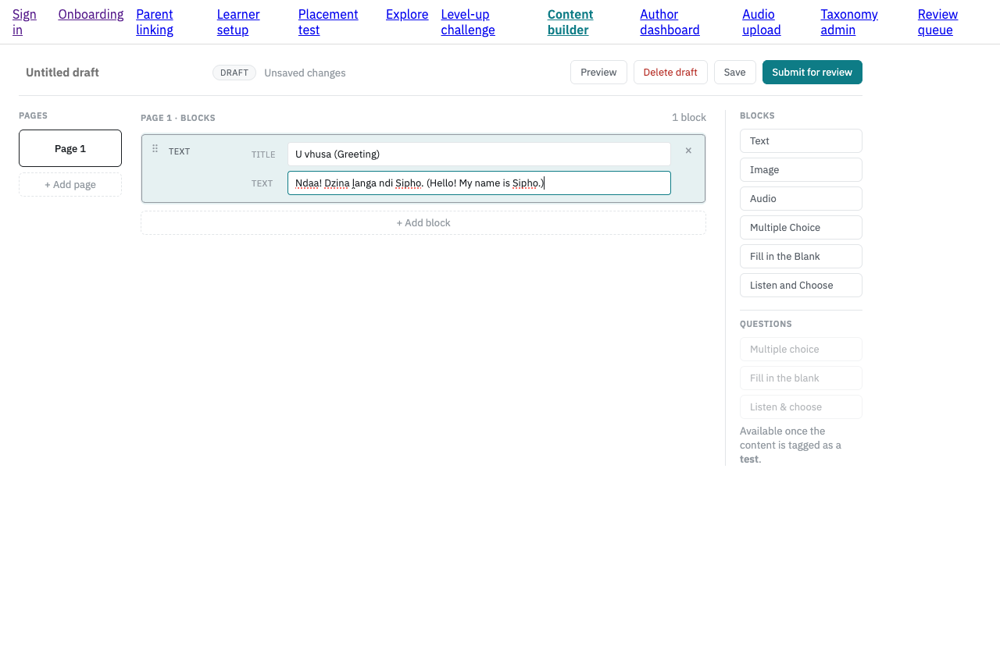

*The text block open for editing.*

## CB-GUI-03

### Switch a block between editing and viewing

**Checks:** Clicking away shows a block as a learner sees it; clicking it again reopens it without losing anything.

**Before:** CB-GUI-02 done: one filled text block is open.

| Step | Do this | Expected result | Observed result |
|---|---|---|---|
| 1 | Click the **Pages** heading, outside every block. | The row is no longer highlighted and has no fields. It shows **U vhusa (Greeting)** as a heading with the Tshivenda sentence underneath. | Pass. As expected. |
| 2 | Click the block. | The fields come back holding both values unchanged. | Pass. As expected. |
| 3 | Invalid value: add another text block, leave it empty, then click **Pages**. | The empty block shows the placeholder heading **Untitled block** in grey italics and no body text. | Pass. As expected. |

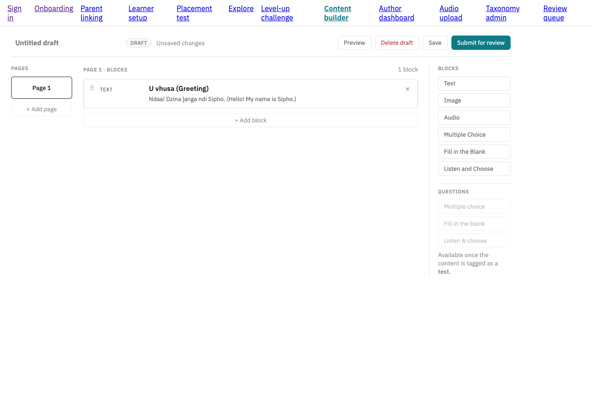

*The same block after clicking away, shown as content.*


*An empty text block reads Untitled block in grey italics.*

## CB-GUI-04

### Give a new block its type

**Checks:** A block added without a type asks for one, and picking a type opens that type's fields.

**Before:** A new draft is open.

| Step | Do this | Expected result | Observed result |
|---|---|---|---|
| 1 | Click **+ Add block**. | A **PENDING SELECTION** row appears reading **Pick a type** with six buttons: **Text**, **Image**, **Audio**, **Multiple Choice**, **Fill in the Blank** and **Listen and Choose**. The count reads **1 block**. | Pass. As expected. |
| 2 | Click **Image**. | The row becomes **IMAGE** with empty **Caption**, **File link** and **Alt text** fields, and the note *Uploading isn't connected yet, so any link works as a placeholder.* | Pass. As expected. |

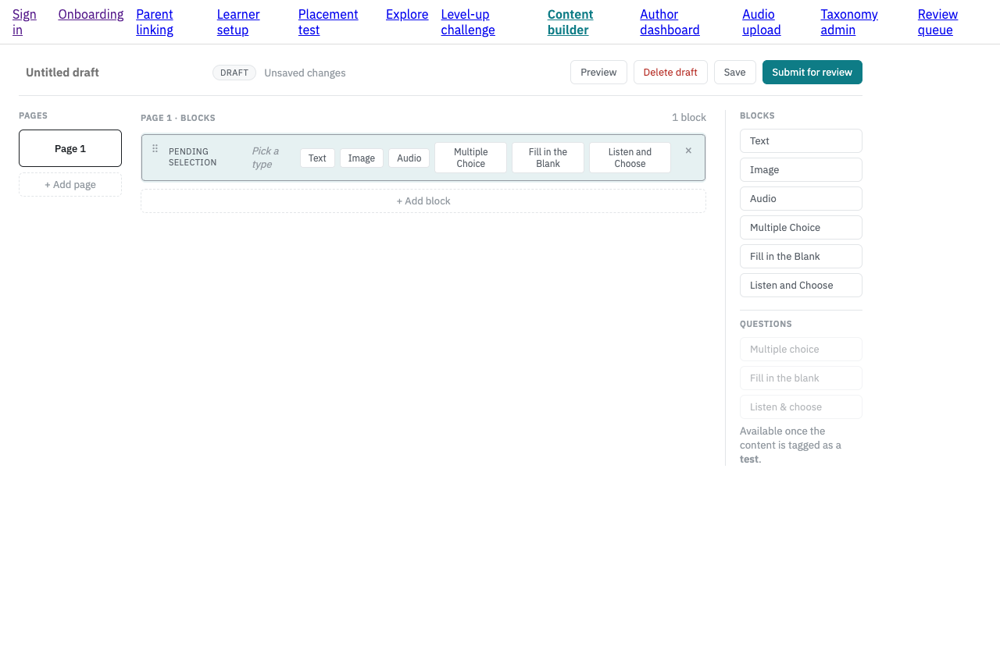

*A block with no type yet, offering all six types.*

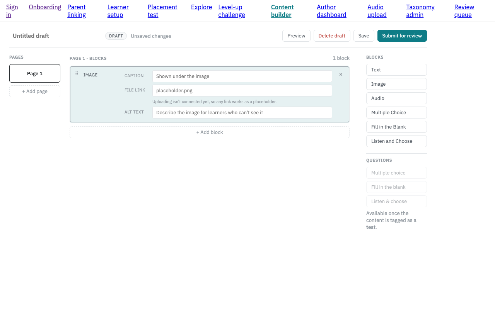

*After picking Image: the image fields.*

## CB-GUI-05

### Image block with a placeholder file

**Checks:** An image block keeps its caption, link and alt text, and shows a placeholder frame instead of loading a file. Image upload is not built yet, so the link is only a placeholder.

**Before:** A new draft is open.

| Step | Do this | Expected result | Observed result |
|---|---|---|---|
| 1 | Click **Image** under Blocks. Enter Caption **Umuthi we-marula (The marula tree)**, File link **http://localhost:4000/uploads/images/marula-tree.png** and Alt text **A tall marula tree with yellow fruit on a sunny day**. | The three fields hold the typed values. | Pass. As expected. |
| 2 | Click **Pages**. | A dashed frame labelled **IMAGE** shows only the file name **marula-tree.png**, not the whole link, with **Umuthi we-marula (The marula tree)** as the caption below. No image is loaded. | Pass. As expected (the page has no `` element). |
| 3 | Invalid value: click **Image** again, leave every field empty, then click **Pages**. | The empty image reads **No file attached**, **No caption** and **No alt text yet**. | Pass. As expected. |

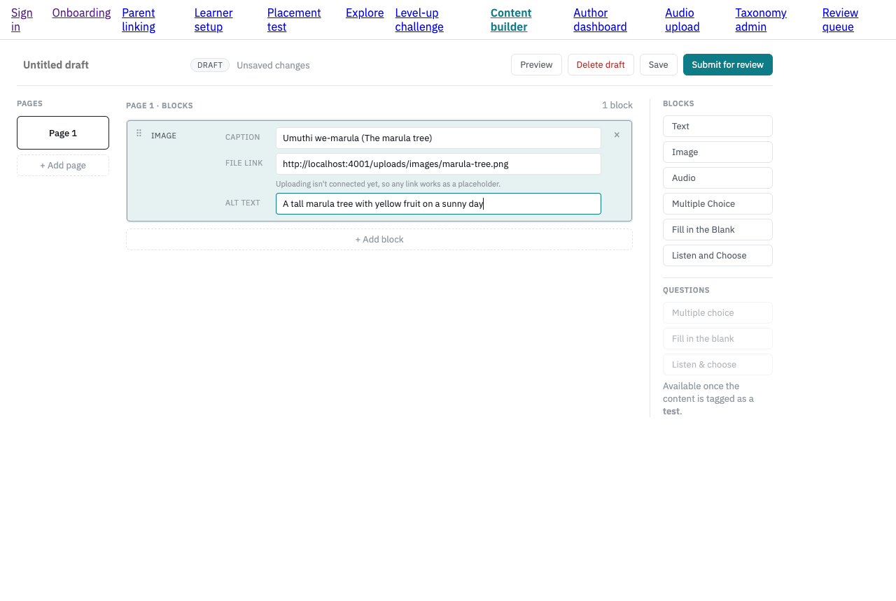

*Editing an image block.*

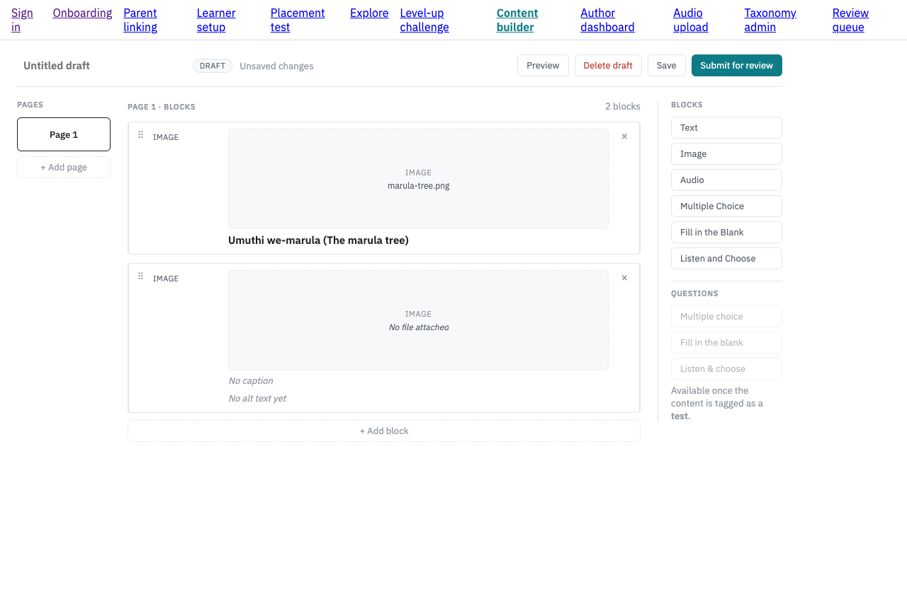

*A filled image block and an empty one, as content.*

## CB-GUI-06

### Audio block with an uploaded clip

**Checks:** An audio block uploads a real clip, refuses a file it can't use, and plays the clip in both the editor and the read-only view.

**Before:** A new draft is open. Browser DevTools open on the Network tab.

| Step | Do this | Expected result | Observed result |
|---|---|---|---|
| 1 | Click **Audio** under Blocks. | The row shows a **Title** field, a **File** line with a **Choose file** button and **No file attached**, and a multi-line **Transcript** box. | Pass. As expected. |
| 2 | Type Title **Sawubona! (Hello!)**. Invalid file: click **Choose file** and try to pick `docs/MO/MO GUI Tests.pdf`. | Either the file dialog greys the PDF out (the picker only offers audio), or, if it can be chosen, a red message **Unsupported format "application/pdf". Please use MP3, WAV, OGG, or WebM.** appears. Nothing is uploaded (no request in the Network tab) and the file line still reads **No file attached**. | Pass. The run set the PDF on the file input directly, bypassing the dialog's filter: the red message appeared, no request was sent, and the line still read **No file attached**. |
| 3 | Invalid file: choose `docs/MO/test3.mp3`. | The message reads **File is 5.1 MB. The maximum allowed size is 5 MB.** Nothing is uploaded. | Pass. As expected. |
| 4 | Choose `docs/MO/test1.mp3`. | The Network tab shows **POST /api/media/uploadAudio → 201**. The button changes to **Change file**, the stored file name appears next to it, and an audio player showing **0:04** appears under it. The error message is gone. | Pass. As expected. The file name shown is the server's stored name (a long random id ending in `.mp3`), not `test1.mp3`. |
| 5 | Type Transcript **Sawubona, unjani? Ngiyaphila, ngiyabonga. (Hello, how are you? I am well, thank you.)**, then click **Pages**. | The block shows **Sawubona! (Hello!)**, a working audio player and **Transcript.** followed by the transcript. Pressing play plays the clip. | Pass. As expected (the player loads the clip, about 4.9 s long). |
| 6 | Invalid value: click **Audio** again, leave every field empty, then click **Pages**. | The empty clip reads **Untitled audio**, a placeholder player bar with **No file attached**, and **No transcript yet**. | Pass. As expected. |
| 7 | Click **Sawubona! (Hello!)** to open it, then click **+ Add block** once. | The clip closes and a new **PENDING SELECTION** block is added below and opened. The count reads **3 blocks**. | Pass. As expected. |

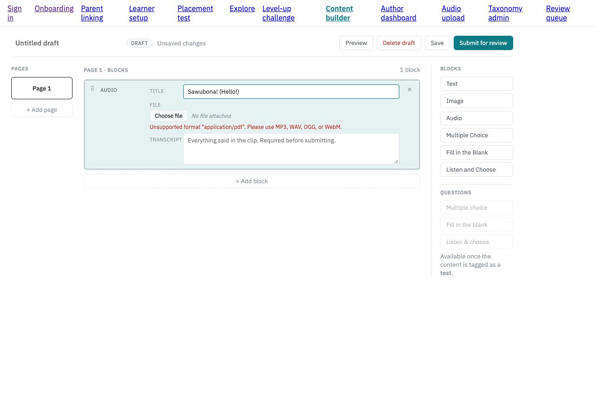

*A file that isn't audio is refused before it is sent.*

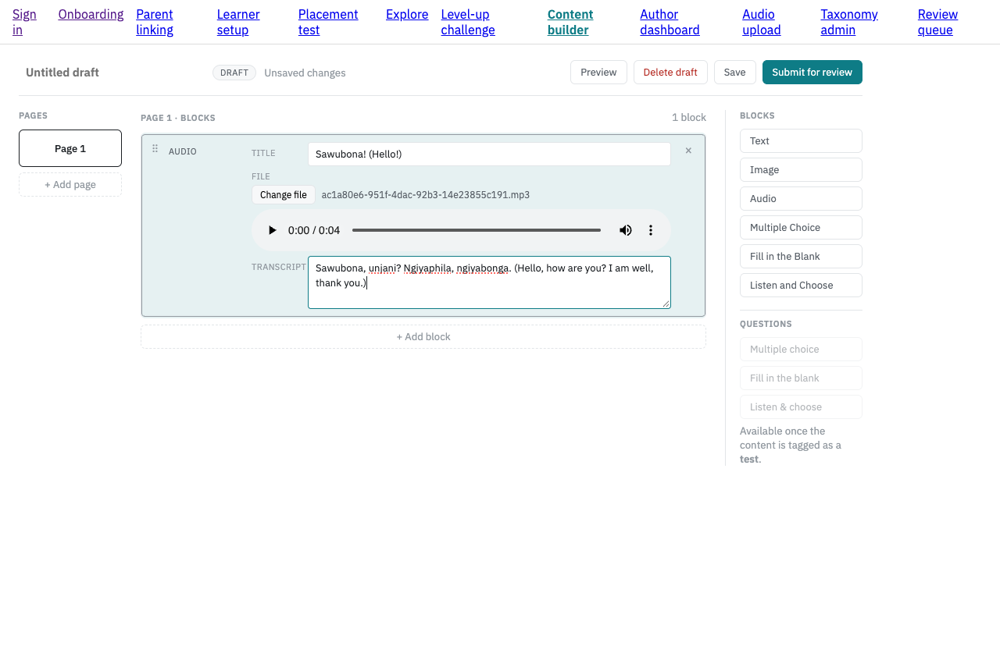

*Editing an audio block after uploading the clip.*

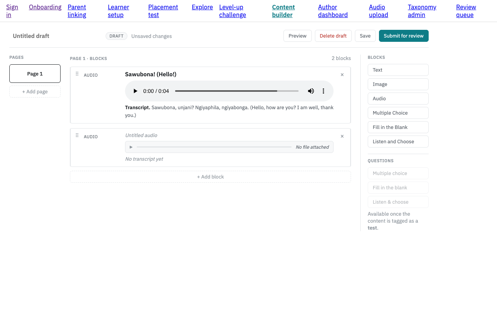

*A filled audio block and an empty one, as content.*

## CB-GUI-07

### Delete a block

**Checks:** Deleting a block removes only that block.

**Before:** A new draft is open.

| Step | Do this | Expected result | Observed result |
|---|---|---|---|
| 1 | Add three text blocks titled **Sawubona (Hello)**, **Unjani? (How are you?)** and **Ngiyaphila (I am well)**, click **Pages**, then click the **×** on **Unjani? (How are you?)**. | Only that block is removed. The page shows **Sawubona (Hello)** then **Ngiyaphila (I am well)**, and the count reads **2 blocks**. | Pass. As expected. |

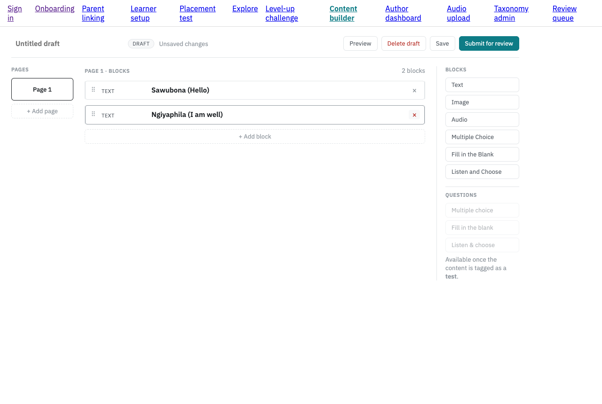

*The middle block removed; the other two remain in order.*

## CB-GUI-08

### Reorder blocks by dragging

**Checks:** Blocks can be moved by dragging the grip, or by pressing and holding the card.

**Before:** A new draft is open.

| Step | Do this | Expected result | Observed result |
|---|---|---|---|
| 1 | Add text blocks **First: Sawubona**, **Second: Unjani?** and **Third: Ngiyaphila**, click **Pages**. Drag the **⠿** grip on **Third** onto the top half of **First** and release. | While dragging, a line marks the drop position above **First** and the dragged card fades. After release the order is **Third**, **First**, **Second**, and the header reads **Unsaved changes**. | Pass. As expected. |
| 2 | Press and hold on the body of **Second** (not the grip) for about half a second, then drag it onto the top half of **Third** and release. | The card is picked up when held (its outline darkens), then drops at the top. The order becomes **Second**, **Third**, **First**. | Pass. As expected. A press shorter than the hold does not pick the card up. |

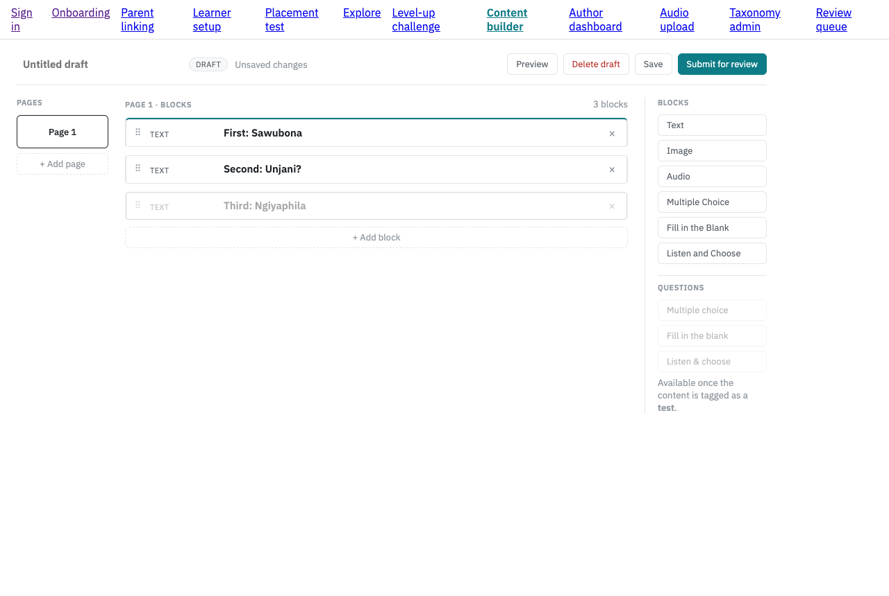

*Dragging Third above First; the line shows where it will land.*

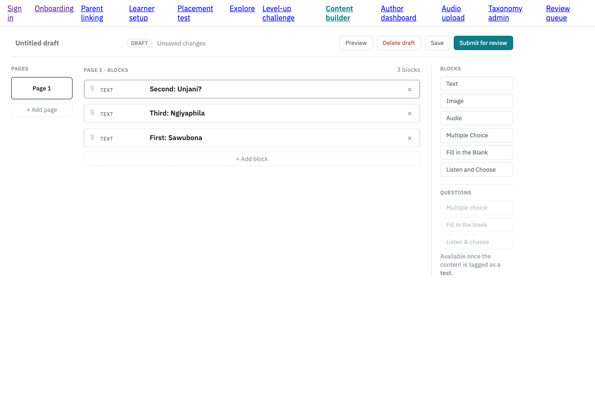

*After both drags: Second, Third, First.*

## CB-GUI-09

### Add, switch and delete pages

**Checks:** Pages can be added, switched between and deleted, and the last page cannot be deleted.

**Before:** A new draft is open.

| Step | Do this | Expected result | Observed result |
|---|---|---|---|
| 1 | Add a text block **Ikhasi lokuqala (Page one)**. Click **+ Add page**. | **Page 2** is added and selected, the canvas reads **Page 2 · blocks** and **0 blocks**, and both page cards now show a delete ×. | Pass. As expected. |
| 2 | Add a text block **Ikhasi lesibili (Page two)**, then click **Page 1**. | The canvas switches to **Page 1 · blocks** showing only **Ikhasi lokuqala (Page one)**. | Pass. As expected. |
| 3 | With **Page 1** selected, click its **×** (**Delete page 1**). | The old second page becomes **Page 1** and stays selected, showing **Ikhasi lesibili (Page two)**. Only one page is left, so no delete × is shown. | Pass. As expected. |
| 4 | Click **+ Add block**. | A new block is added to the remaining page (**2 blocks**). | Pass. As expected. |

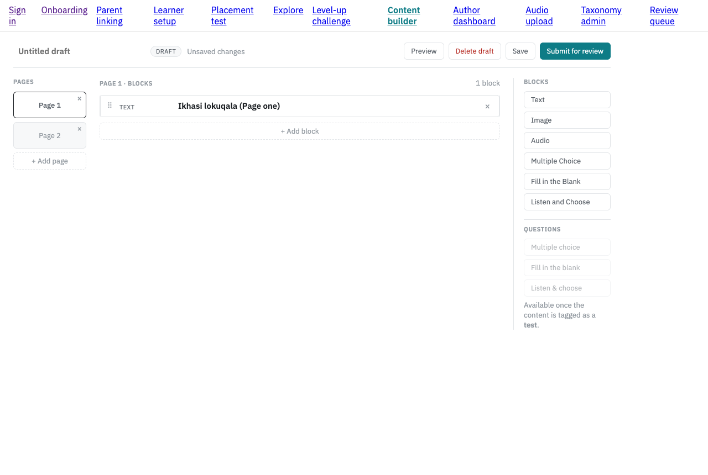

*Two pages, with Page 1 selected.*

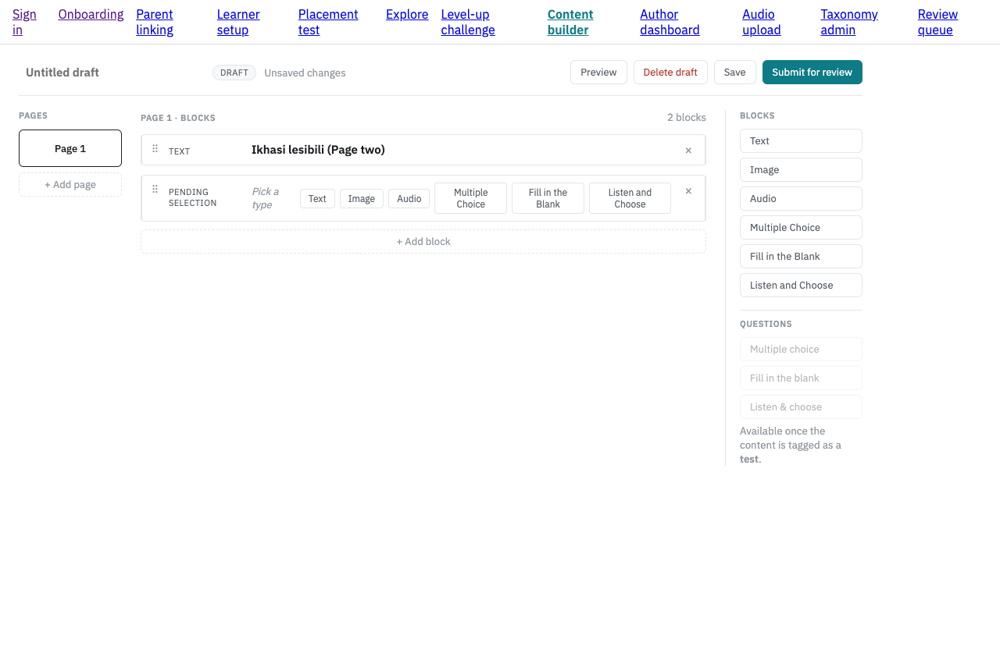

*After deleting the selected first page, the remaining page is selected and still takes new blocks.*

## CB-GUI-10

### Save a draft and open it again

**Checks:** The first save creates the draft on the server, later saves update the same draft, and the draft can be opened again from its own address.

**Before:** A new draft is open. Browser DevTools open on the Network tab.

| Step | Do this | Expected result | Observed result |
|---|---|---|---|
| 1 | Type **Greetings in isiZulu** in the title field in the header. Add a text block **Sawubona (Hello)** / **Sawubona means hello to one person.**, click **Pages**, then click **Save**. | The Network tab shows **POST /api/content/createContent → 201**. The button changes to **Saved** and is disabled, the header reads **All changes saved** with the title still in place, and the address becomes `/content-builder/<id>` with the new draft's id. | Pass. As expected. |
| 2 | Click the block, change Text to **Sawubona means hello to one person. Sanibonani greets a group.**, click **Pages**, then **Save**. | The header shows **Unsaved changes** until saved. The Network tab shows **PUT /api/content/editContent/<id> → 200**, using the id created by the first save. | Pass. As expected (`<id>` was 9 in the first run and 18 in the regression run). |
| 3 | Open `/content-builder/<id>` in the address bar (a full reload). | The builder opens the saved draft: title **Greetings in isiZulu**, **Draft** chip, **All changes saved**, and the block with the edited text. | Pass. As expected. |

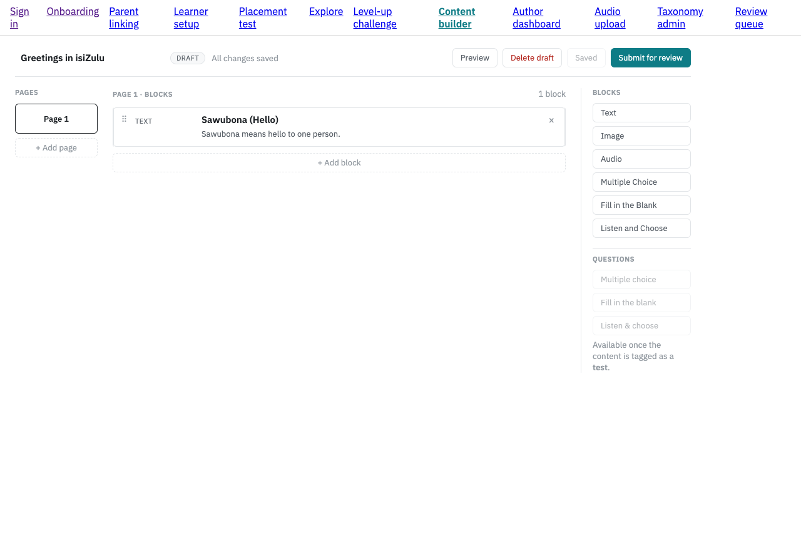

*After the first save.*

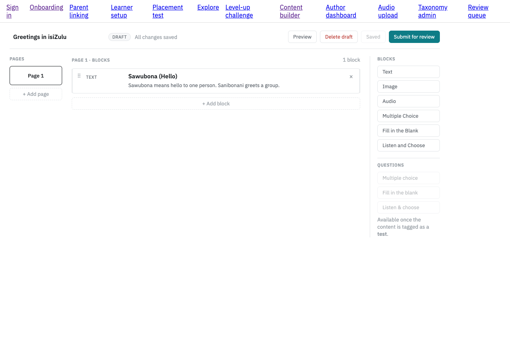

*The same draft opened again from /content-builder/&lt;id&gt; after a reload.*

## CB-GUI-11

### Submit screen blocks an incomplete draft

**Checks:** The submit screen lists every check, shows which fail, and keeps Submit disabled.

**Before:** A new draft is open.

| Step | Do this | Expected result | Observed result |
|---|---|---|---|
| 1 | Build: page 1 with a text block titled **Sawubona** with empty Text, an audio block titled **Clip** with no file and no transcript, and a block with no type (**+ Add block**). Add an empty **Page 2**. Click **Submit for review**. | The submit screen opens with **Editing is off here.** Both pages are shown read only: page 1 shows its blocks (the untyped one reads **This block has no type yet**) and page 2 reads **This page has no blocks.** The type chip reads **Story**. The Checks card has fourteen lines. These show **!**: **Title written**, **Language chosen**, **Level chosen**, **Theme chosen (exactly one)**, **Audience chosen**, **Every page has at least one block**, **Every block has a type**, **Every text block has a title and text** and **Every audio clip has a file and a transcript**. The other five pass with **✓**, since the draft has nothing they apply to or too many of. **Submit for review** is disabled. | Pass. As expected. |

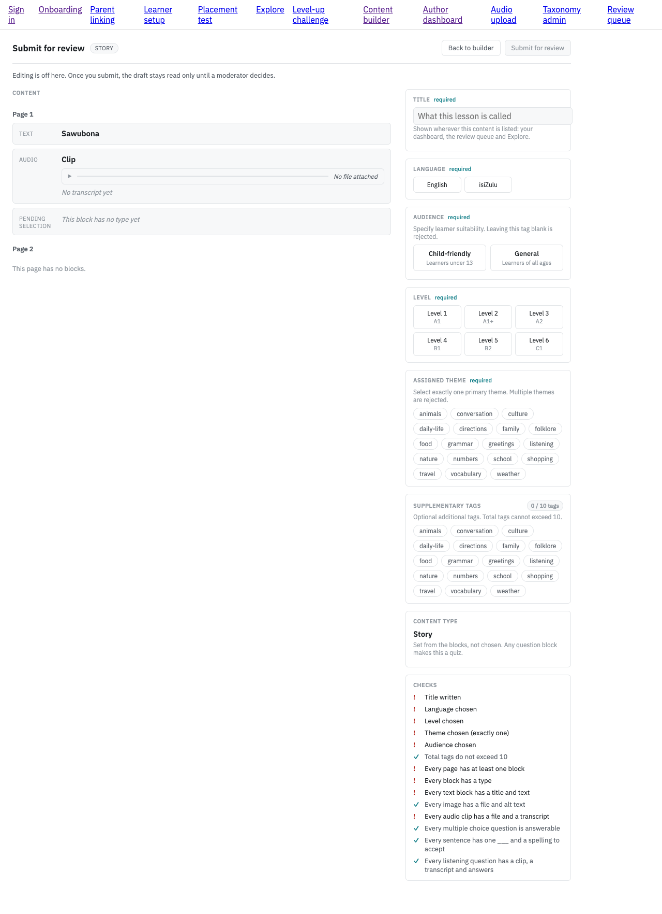

*An incomplete draft: nine checks fail and Submit is disabled.*

## CB-GUI-12

### Fix the draft and fill in title, language, audience, level and tags

**Checks:** Each fix clears its check; language, audience, level and theme are single choice; supplementary tags are toggles counted against a limit of 10; and Submit enables once every check passes.

**Before:** CB-GUI-11 done: the submit screen shows the incomplete draft.

| Step | Do this | Expected result | Observed result |
|---|---|---|---|
| 1 | Click **Back to builder**, then click **Page 1**. | The builder shows the same draft unchanged, still on **Page 2**, the page open before submitting. After clicking **Page 1** it shows Sawubona, Clip and the untyped block. | Pass. As expected. |
| 2 | On Page 1: give Sawubona the Text **Sawubona! Unjani? (Hello! How are you?)**; open Clip, upload `docs/MO/test1.mp3` and type Transcript **Sawubona. (Hello.)**; delete the untyped block. Delete **Page 2**. Click **Submit for review**. | Only **Title written**, **Language chosen**, **Level chosen**, **Theme chosen (exactly one)** and **Audience chosen** still fail. Submit stays disabled. | Pass. As expected. |
| 3 | Type **Greetings in isiZulu** in the Title card, then click **isiZulu** under Language. | **Title written** and **Language chosen** pass; only **isiZulu** is highlighted. | Pass. As expected. |
| 4 | Under Audience click **Child-friendly**, then **General**. Then click **General** again, and once more. | After the first two clicks only **General** is highlighted. Clicking it again clears it and **Audience chosen** fails; clicking once more selects it again and the check passes. | Pass. As expected. |
| 5 | Click **Level 4**, then **Level 6**, then **Level 4** again. | Only one level is highlighted at a time; after the last click only **Level 4** is. **Level chosen** passes. | Pass. As expected. |
| 6 | Under Assigned Theme click **food**, then **greetings**. | Only **greetings** is highlighted, and it disappears from the Supplementary Tags list. **Theme chosen (exactly one)** passes. | Pass. As expected. |
| 7 | Under Supplementary Tags click **conversation**, **listening**, then **conversation** again. | Only **listening** is highlighted and the badge reads **2 / 10 tags** (theme plus one). There is no text box to type a new tag. | Pass. As expected. |
| 8 | Check the Checks card and the Submit button. | All fourteen checks show **✓** and **Submit for review** is enabled. | Pass. As expected. |

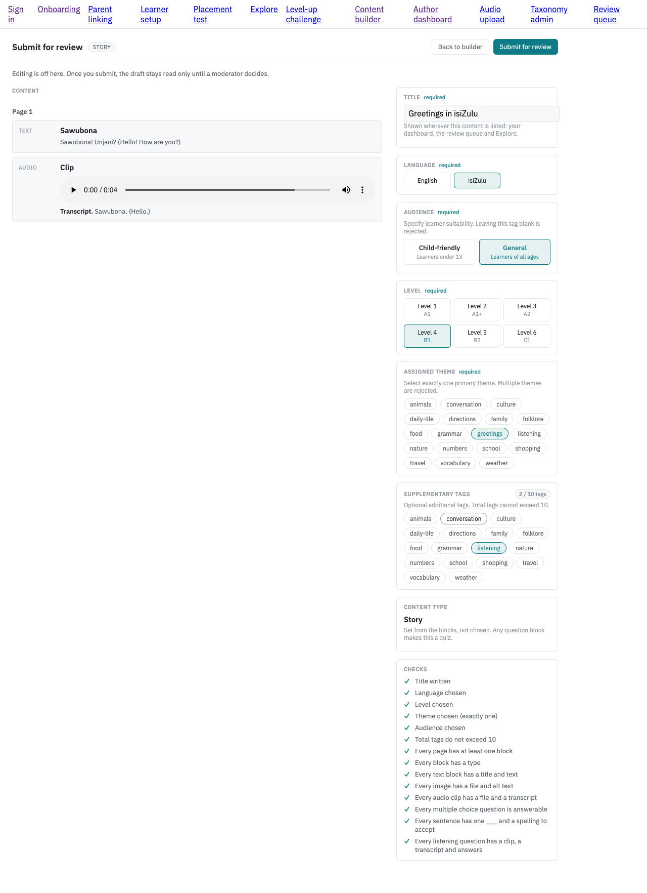

*A complete draft: every check passes and Submit is enabled.*

## CB-GUI-13

### Submit locks the draft

**Checks:** Submitting sends the draft for review and makes it read only everywhere, including when it is opened again.

**Before:** CB-GUI-12 done: the submit screen shows a draft that passes every check. Browser DevTools open on the Network tab.

| Step | Do this | Expected result | Observed result |
|---|---|---|---|
| 1 | Click **Submit for review**. | The Network tab shows **POST /api/content/createContent → 201** (the draft was never saved) then **POST /api/content/submitContent/<id> → 200**. The builder opens at `/content-builder/<id>` with a **Pending review** chip and the banner **Submitted for review. This draft is read only until a moderator decides.** | Pass. As expected (`<id>` was 10). In the first run the address stayed `/content-builder`; since the follow-up fix it shows the id. |
| 2 | Look at the controls, then click a block. | The title field is disabled. **Delete draft**, **Saved** and **Pending review** are disabled, and so are **+ Add page**, **+ Add block** and all six block buttons. **Preview** and a new **Start a new draft** button are enabled. No block or page shows a delete ×. Clicking a block opens no fields. | Pass. As expected. |
| 3 | Press the browser **Back** button to return to the submit screen. | The title field and every language, audience, level and tag button are disabled, with **isiZulu**, **General**, **Level 4**, **greetings** and **listening** still highlighted. **Submit for review** is disabled. | Pass. As expected. |
| 4 | Open `/content-builder/<id>` in the address bar (a full reload). | The draft opens locked: **Pending review** chip, the read-only banner, and only **Preview**, **Start a new draft** and the page button enabled. | Pass. As expected. |
| 5 | In the console run `await api('getContent/<id>')`, then `await api('editContent/<id>', {method:'PUT', body: JSON.stringify({content:[[]]})})`. | The first returns **200** with `status: "pending"`, `level: 4`, `language: "zulu"` and `chosenTags: ["greetings","listening"]`. The edit is refused with **409** `only a draft can be changed`. | Pass. As expected. |
| 6 | Click **Start a new draft**. | The address changes to `/content-builder` and a new empty draft opens: **Draft** chip, empty title, **Page 1**, **0 blocks**, **All changes saved**. | Pass. As expected. |

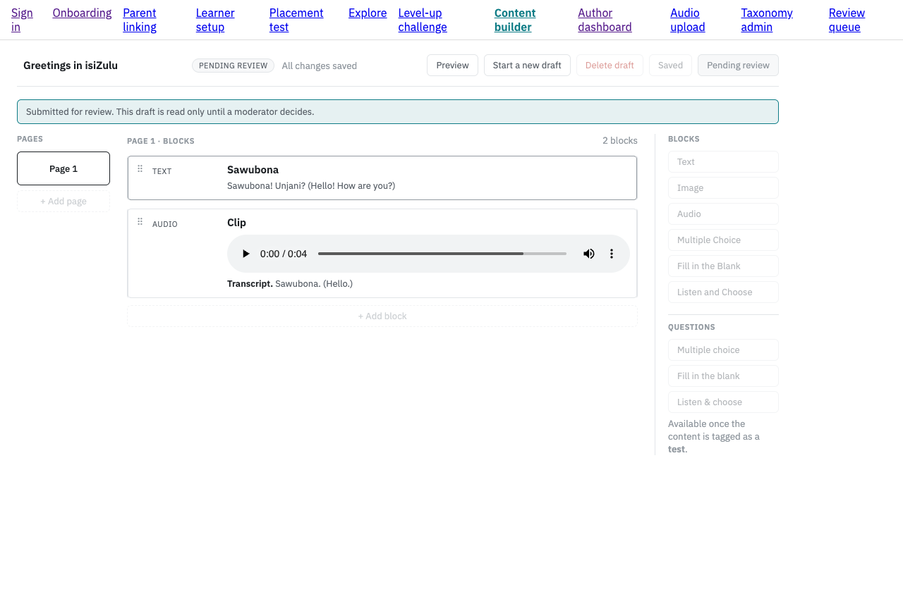

*The submitted draft, read only.*

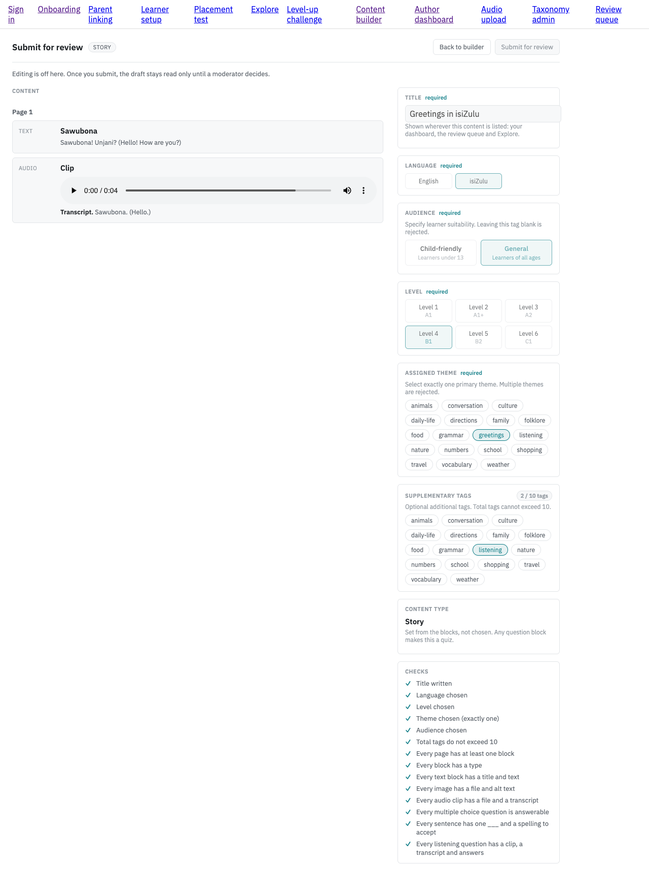

*Back on the submit screen after submitting: every choice is kept and disabled.*

## CB-GUI-14

### Delete a draft

**Checks:** Deleting asks for confirmation, removes the draft from the server, and starts a new empty draft.

**Before:** A new draft is open. Browser DevTools open on the Network tab.

| Step | Do this | Expected result | Observed result |
|---|---|---|---|
| 1 | Type the title **Practice draft**, add a text block **Ukuvalelisa (Saying goodbye)** / **Sala kahle. (Stay well.)**. Click **Save**, then **Delete draft**. | A confirmation dialog asks **Delete this draft? This cannot be undone.** | Pass. As expected. |
| 2 | Click **OK** in the dialog. | The Network tab shows **DELETE /api/content/deleteContent/<id> → 200**. The builder shows a new empty draft: empty title, **Page 1**, **0 blocks** and **All changes saved**. The address, which showed `/content-builder/<id>` after the save, goes back to `/content-builder`. | Pass. As expected. |
| 3 | In the console run `await api('getContent/<id>')` with the id from the save. | The response is **404** `content not found`. | Pass. As expected. |
| 4 | Cancel: add a text block **Ngizobuya (I will come back)**, click **Delete draft**, then click **Cancel** in the dialog. | Nothing is deleted: the block stays on the page, the header still reads **Unsaved changes**, and no DELETE request is sent. | Pass. As expected. |

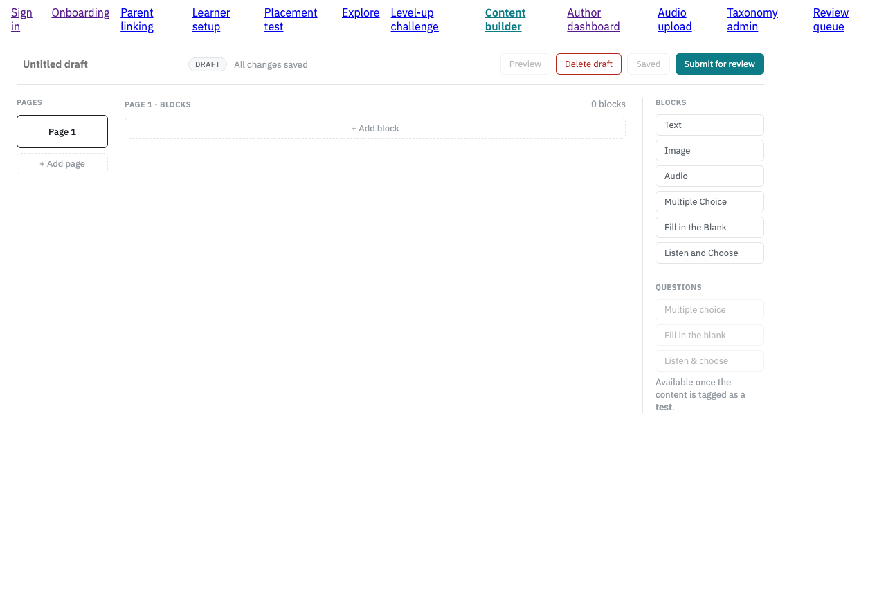

*After deleting: a new, empty draft.*

## CB-GUI-15

### Saving while the server is down

**Checks:** A failed save tells the author and keeps their unsaved work.

**Before:** A new draft is open. **Stop the backend** (Ctrl+C in its terminal).

| Step | Do this | Expected result | Observed result |
|---|---|---|---|
| 1 | Add a text block **Ngiyabonga (Thank you)** / **Ngiyabonga kakhulu. (Thank you very much.)**. Click **Save**. | A red message **Error saving this draft** appears under the header. The button still reads **Save** and stays enabled, the header still reads **Unsaved changes**, and the block is still on the page. | Pass. As expected (the request failed with a refused connection). |
| 2 | Start the backend again and click **Save**. | **POST /api/content/createContent → 201**, the red message disappears, the header reads **All changes saved** and the address becomes `/content-builder/<id>`. | Pass. As expected. |

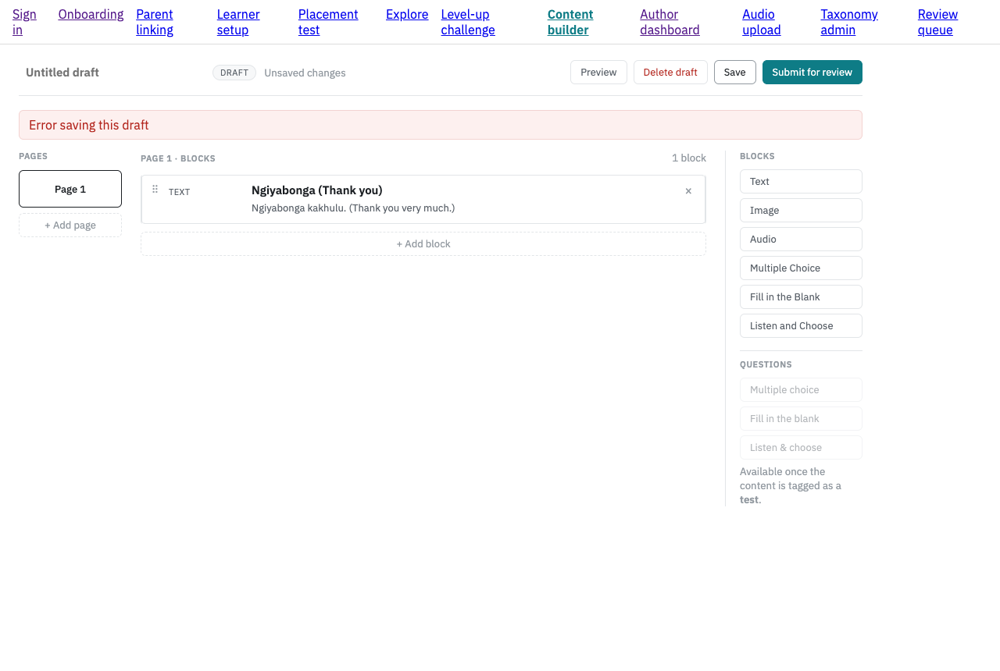

*Saving with the backend stopped.*

## CB-GUI-16

### Multiple choice block

**Checks:** A multiple choice question takes a question and 2 to 6 answers, one marked right, and shows the right answer ticked when read.

**Before:** A new draft is open.

| Step | Do this | Expected result | Observed result |
|---|---|---|---|
| 1 | Click **Multiple Choice** under Blocks. | A **MULTIPLE CHOICE** row opens with a **Multiple choice** group: **Title**, **Question**, and **Answers** with two empty answer rows. Each row has a radio button, a text box and a ×. Both × are disabled (two is the minimum). **Add an answer** is enabled. The hint reads *The marked answer is the right one. It is never shown to a learner.* The first radio is selected. | Pass. As expected. |
| 2 | Title **Ukubingelela (Greetings)**, Question **How do you greet one person in isiZulu?** | Both fields hold the typed values. | Pass. As expected. |
| 3 | Click **Add an answer** four times, then fill the six answers: **Sanibonani**, **Sawubona**, **Hamba kahle**, **Ngiyabonga**, **Yebo**, **Cha**. | There are six answer rows, every × is enabled, and **Add an answer** is disabled (six is the maximum). | Pass. As expected. |
| 4 | Click the × on **Cha**, then on **Yebo**. | Four answers are left and **Add an answer** is enabled again. | Pass. As expected. |
| 5 | Click the radio button next to **Sawubona**. | Only the **Sawubona** radio is selected. | Pass. As expected. |
| 6 | Click **Pages**. | The block shows **Ukubingelela (Greetings)**, the question, and a numbered list of the four answers. **Sawubona** is bold with a ✓ and the label **RIGHT ANSWER**; the others are plain. | Pass. As expected. |

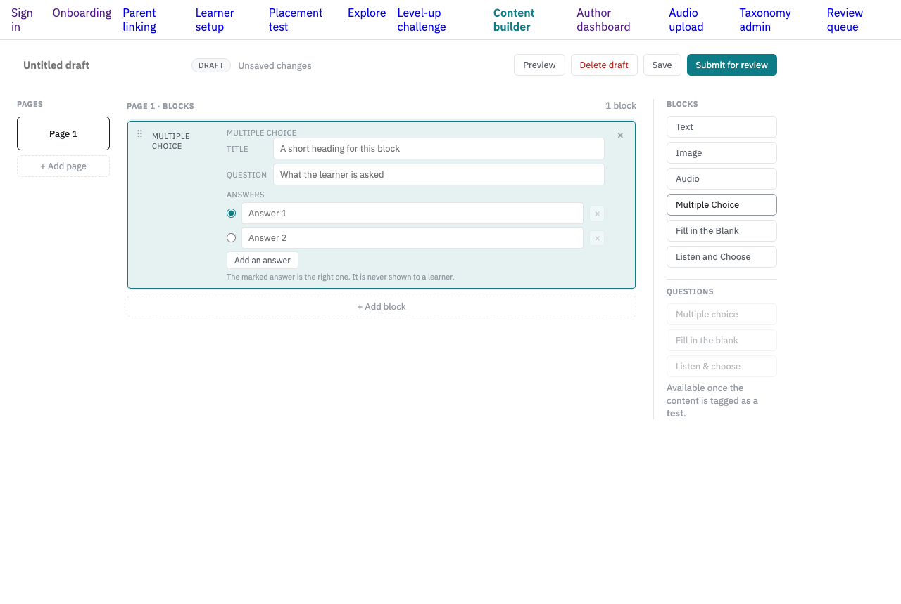

*A new question: two empty answers, neither can be removed.*

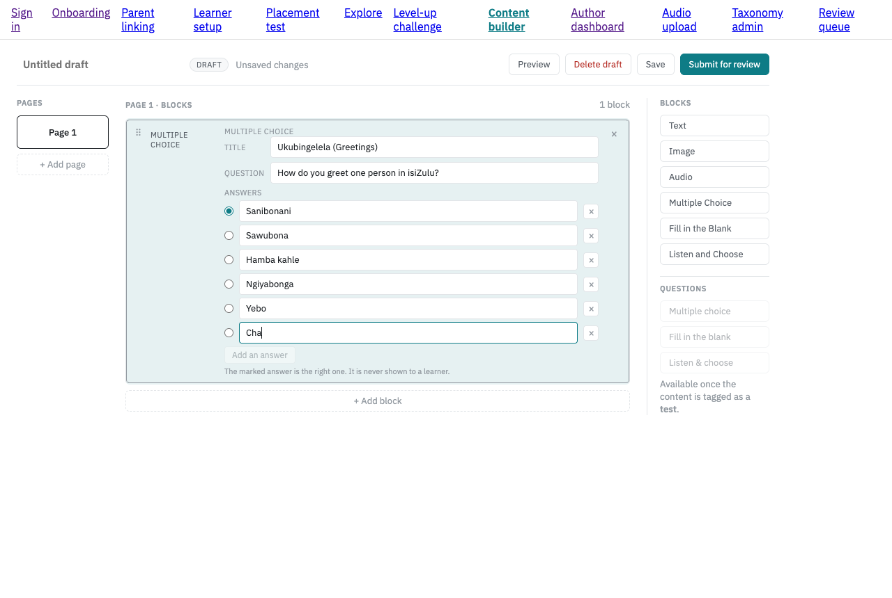

*Six answers: Add an answer is disabled.*

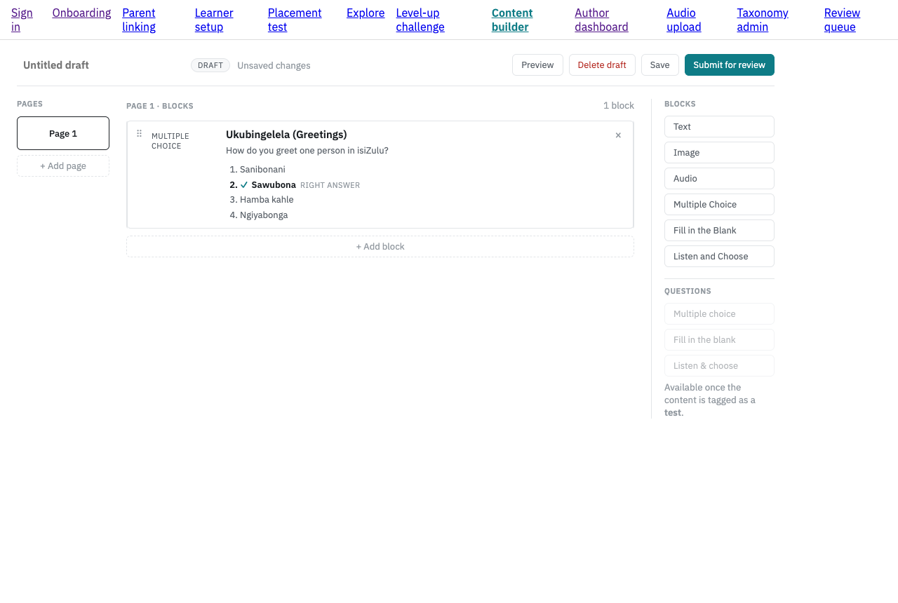

*Read only: the right answer is ticked.*

## CB-GUI-17

### Fill in the blank block

**Checks:** A fill in the blank question takes a sentence with `___` and 1 to 6 accepted spellings, and draws the gap as a line when read.

**Before:** A new draft is open.

| Step | Do this | Expected result | Observed result |
|---|---|---|---|
| 1 | Click **Fill in the Blank** under Blocks. | A **FILL IN THE BLANK** row opens with a **Fill in the blank** group: **Title**, **Sentence** (placeholder *Type ___ where the missing word goes*), the hint *Write ___ in the sentence to mark the gap.*, and **Accepts** with one empty spelling whose × is disabled. **Accept another spelling** is enabled. | Pass. As expected. |
| 2 | Title **Ukubonga (Saying thank you)**, Sentence **Uma umuntu ekusizile, uthi ___ kakhulu. (When someone has helped you, you thank them very much.)** | Both fields hold the typed values. | Pass. As expected. |
| 3 | Click **Accept another spelling** five times. Type **ngiyabonga** in the first spelling and **Ngiyabonga** in the second. | There are six spelling rows and **Accept another spelling** is disabled (six is the maximum). | Pass. As expected. |
| 4 | Click the × on spellings 6, 5, 4 and 3 (the empty ones). | Two spellings are left, **ngiyabonga** and **Ngiyabonga**, and **Accept another spelling** is enabled again. | Pass. As expected. |
| 5 | Click **Pages**. | The block shows **Ukubonga (Saying thank you)** and the sentence with the `___` replaced by an empty underlined gap, then **Accepts.** **ngiyabonga, Ngiyabonga**. | Pass. As expected (the gap is a grey bottom border about 68 px wide, read out as "the missing word"). |

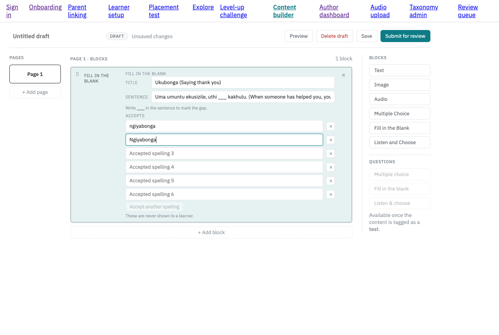

*Six accepted spellings: the add button is disabled.*

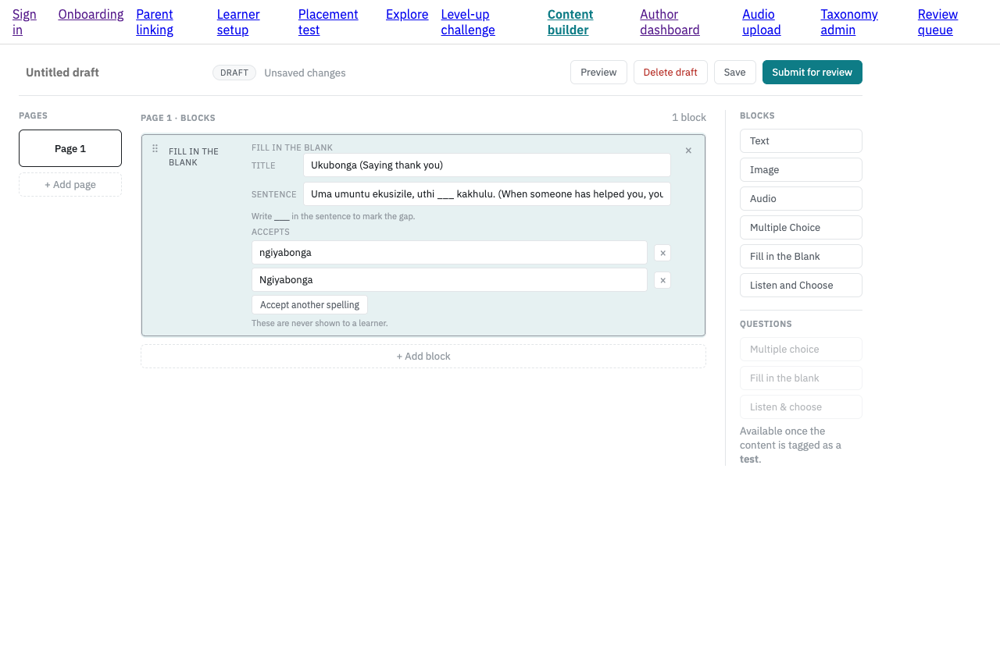

*The question with two accepted spellings.*

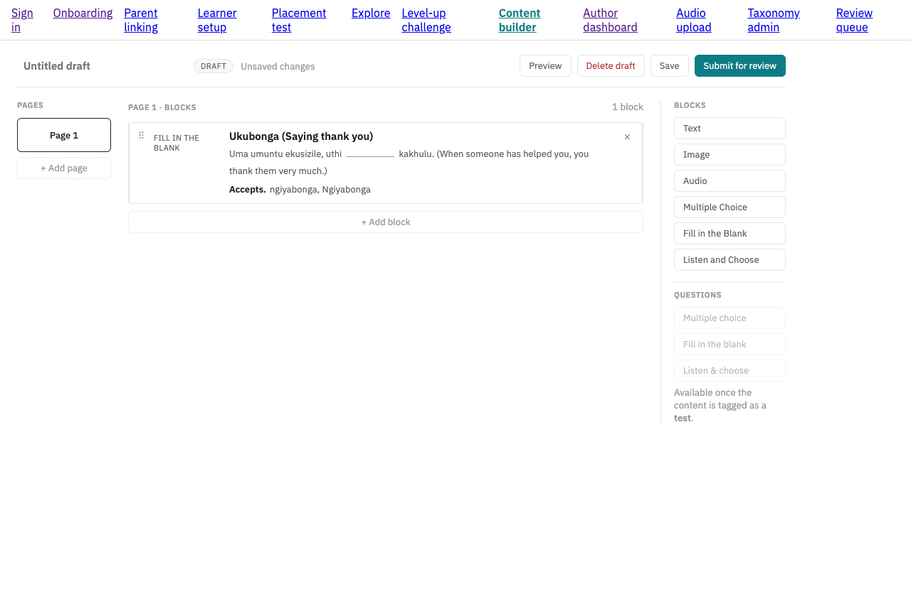

*Read only: the gap is drawn as a line.*

## CB-GUI-18

### Listen and choose block

**Checks:** A listening question uploads a clip, keeps a transcript and answers with the right one marked, and plays the clip when read.

**Before:** A new draft is open. Browser DevTools open on the Network tab.

| Step | Do this | Expected result | Observed result |
|---|---|---|---|
| 1 | Click **Listen and Choose** under Blocks. | A **LISTEN AND CHOOSE** row opens with a **Listen and choose** group: **Title**, **File** with **Choose file** and **No file attached**, **Transcript**, and **Answers** with two empty rows. | Pass. As expected. |
| 2 | Title **Lalela (Listen)**. Click **Choose file** and pick `docs/MO/test1.mp3`. | **POST /api/media/uploadAudio → 201**. The button reads **Change file**, the stored file name is shown and a player appears. | Pass. As expected. |
| 3 | Transcript **Sawubona! Ngiyakwamukela. (Hello! Welcome.)**. Answers **A greeting** and **A goodbye**, click **Add an answer** and type **A question about the weather**. Mark **A greeting** with its radio. | The fields hold the typed values and only the first radio is selected. | Pass. As expected. |
| 4 | Click **Pages**. | The block shows **Lalela (Listen)**, a working audio player (0:04), **Transcript.** with the transcript, and the three answers with **A greeting** ticked and labelled **RIGHT ANSWER**. | Pass. As expected. |

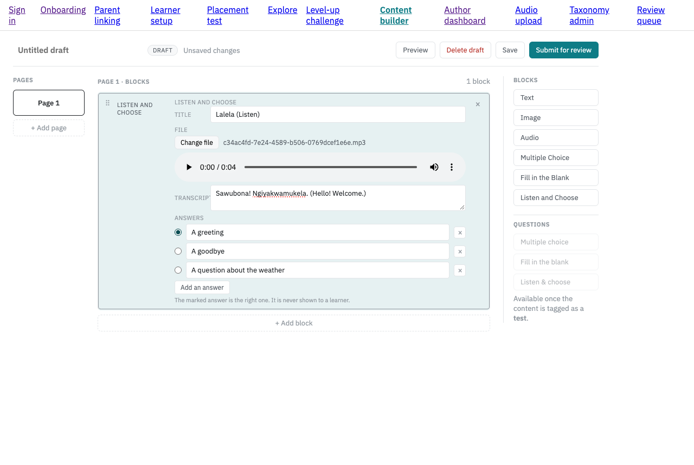

*Editing a listening question after uploading the clip.*

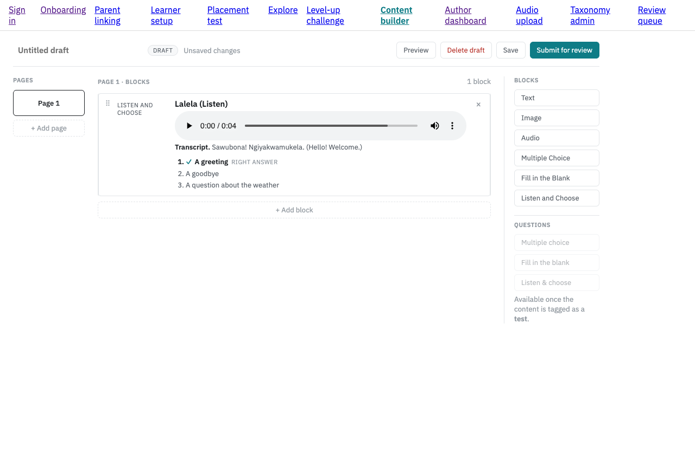

*Read only: player, transcript and the right answer ticked.*

## CB-GUI-19

### Submit checklist with questions

**Checks:** An unfinished question fails its line on the submit screen and keeps Submit disabled; finishing it makes the line pass.

**Before:** A new draft is open. Browser DevTools open on the Network tab.

| Step | Do this | Expected result | Observed result |
|---|---|---|---|
| 1 | Add three unfinished questions. **Multiple Choice**: Title **Ukubingelela (Greetings)**, Question **How do you greet one person in isiZulu?**, answer 1 **Sawubona**, answer 2 left empty. **Fill in the Blank**: Title **Ukubonga (Saying thank you)**, Sentence **Uma umuntu ekusizile, uthi kakhulu.** (no `___`), spelling **ngiyabonga**. **Listen and Choose**: Title **Lalela (Listen)**, no file, Transcript **Sawubona! Ngiyakwamukela. (Hello! Welcome.)**, answers **A greeting** and **A goodbye**. Click **Pages**, then **Submit for review**. Fill in Title **Greetings quiz**, Language **isiZulu**, Audience **General**, **Level 1** and theme **greetings**. | The chip and Content type read **Quiz**. The first eleven checks pass. **Every multiple choice question is answerable**, **Every sentence has one ___ and a spelling to accept** and **Every listening question has a clip, a transcript and answers** show **!**. **Submit for review** is disabled. | Pass. As expected. |
| 2 | **Back to builder**, open the multiple choice block, type **Sanibonani** as answer 2, click **Pages**, **Submit for review**. | **Every multiple choice question is answerable** now passes; the other two question lines still fail. | Pass. As expected. |
| 3 | **Back to builder**, open the fill in the blank block, change the sentence to **Uma umuntu ekusizile, uthi ___ kakhulu.**, click **Pages**, **Submit for review**. | **Every sentence has one ___ and a spelling to accept** now passes; the listening line still fails. | Pass. As expected. |
| 4 | **Back to builder**, open the listening block, upload `docs/MO/test1.mp3`, click **Pages**, **Submit for review**. | All fourteen checks pass and **Submit for review** is enabled. | Pass. As expected. |
| 5 | Click **Submit for review**. | **POST /api/content/createContent → 201** then **POST /api/content/submitContent/<id> → 200**; the builder shows **Pending review** at `/content-builder/<id>`. The server accepts the questions. | Pass. As expected. |

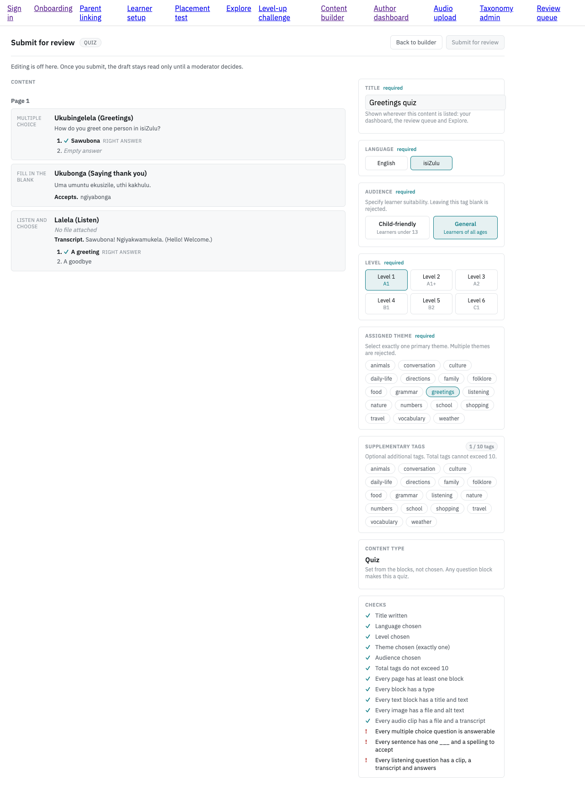

*Unfinished questions: their three lines fail and Submit is disabled.*

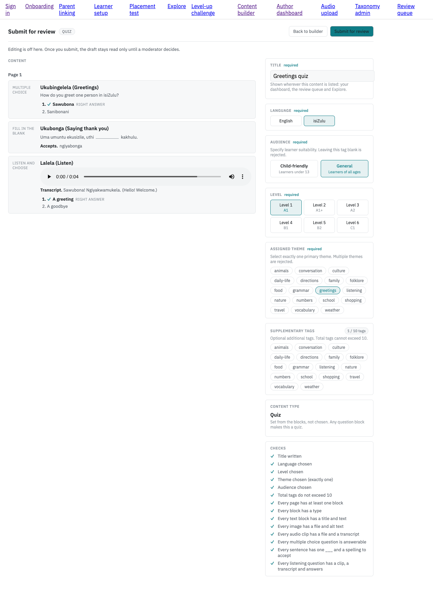

*Every question finished: every line passes and Submit is enabled.*

## CB-GUI-20

### Author preview

**Checks:** **Preview** shows the draft in the learner's own reader, as a learner would see it, without saving anything.

**Before:** A new draft is open.

| Step | Do this | Expected result | Observed result |
|---|---|---|---|
| 1 | Title **Greetings in isiZulu**. Add, in order: a text block **Sawubona (Hello)** / **Sawubona is how you greet one person. To greet a group, say Sanibonani.**; an audio block **Lalela (Listen)** with `docs/MO/test1.mp3` and a transcript; a multiple choice question (as in CB-GUI-16); a fill in the blank question (as in CB-GUI-17); a listen and choose question (as in CB-GUI-18). Click **Pages**, then **Preview**. | The canvas is replaced by the note *This is the learner's own reader, showing the draft as it stands. Nothing here is saved.* and the reader: the title, **by One Author**, the read-aloud practice box, the text block, the audio block with a player and **Show transcript**, then each question as a learner would answer it, and **Page 1 of 1** with Prev and Next disabled. The button now reads **Back to editing**. | **Known gap.** Title, byline, text block, audio player (loads on play) and page controls appear as expected. The three question blocks are **not** shown as questions: each is replaced by a red line, **No renderer yet for block type: "Multiple Choice"**, **… "Fill in the Blank"** and **… "Listen and Choose"**. The learner reader's `BlockRenderer` only knows text, image and audio; it has not been wired to question components yet. |
| 2 | Click **Back to editing**. | The editor comes back with all five blocks unchanged, and the header still reads **Unsaved changes** (preview saved nothing). | Pass. As expected. |

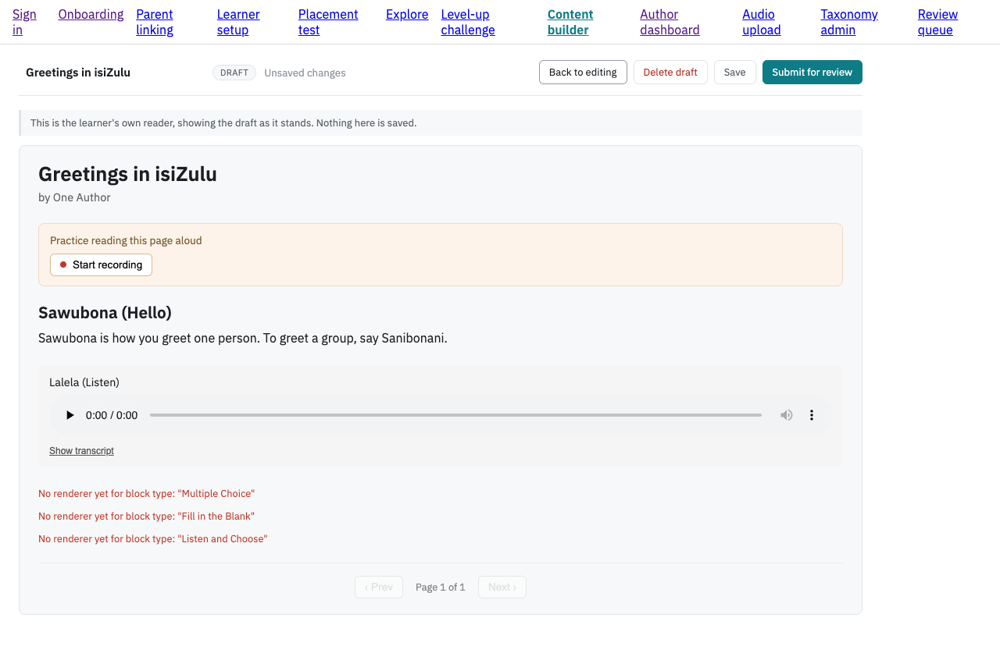

*Preview: text and audio render; question blocks show "No renderer yet".*

## CB-GUI-21

### Content size limit

**Checks:** Text in a block over 2000 characters can't be saved or submitted, and the author is told why.

**Before:** A new draft is open. Browser DevTools open on the Network tab. In the console, run `copy('Sawubona! '.repeat(200) + 'A')` to put a 2001-character text on the clipboard (and `copy('Sawubona! '.repeat(200))` for exactly 2000).

| Step | Do this | Expected result | Observed result |
|---|---|---|---|
| 1 | Title **Long greeting practice**. Add a text block **Phinda (Repeat after me)** and paste the 2001-character text as its Text. Click **Pages**, then **Save**. | The server refuses it (**POST /api/content/createContent → 400**, body `text in a block can be at most 2000 characters`) and the screen shows a message saying text can be at most 2000 characters. The draft stays unsaved and the text stays on the page. | Pass. **POST /api/content/createContent → 400** and the red message reads **text in a block can be at most 2000 characters**. The header still reads **Unsaved changes**, the address stays `/content-builder`, and the text is kept. (Before the follow-up fix this showed only the generic **Error saving this draft**.) |
| 2 | Boundary: open the block, replace the Text with exactly 2000 characters, click **Pages**, **Save**. | **POST /api/content/createContent → 201**, the red message goes, the header reads **All changes saved**, and the address becomes `/content-builder/<id>`. | Pass. As expected (`<id>` was 17). |
| 3 | Open `/content-builder` in the address bar (a full reload) for a new draft. Add a text block with the 2001-character text, click **Submit for review**, fill in title, language, audience, level and theme, and click **Submit for review** (the checklist has no length check, so it is enabled). | The submit is refused and the screen says text can be at most 2000 characters. | Pass. **POST /api/content/createContent → 400**; the red message on the submit screen reads **text in a block can be at most 2000 characters**. (Before the fix: **Error submitting this draft**.) |
| 4 | Open the draft saved in step 2 (`/content-builder/<id>`), make its text 2001 characters, click **Submit for review**, choose the details and click **Submit for review**. | As step 3. | Pass. **POST /api/content/submitContent/<id> → 400** and the screen shows **text in a block can be at most 2000 characters**. On this reopened draft **General** was already selected (see CB-GUI-22 step 5), so it must not be clicked again. |

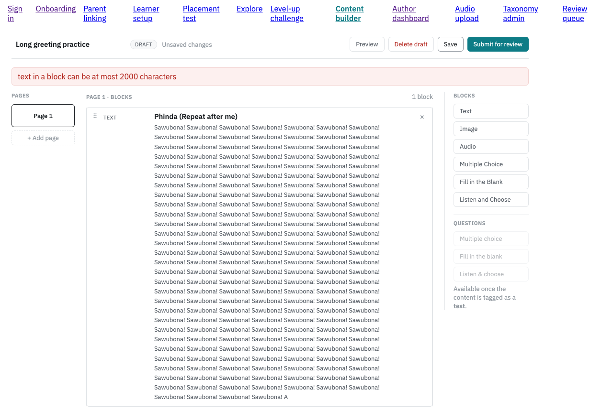

*Saving 2001 characters: the server's reason is shown.*

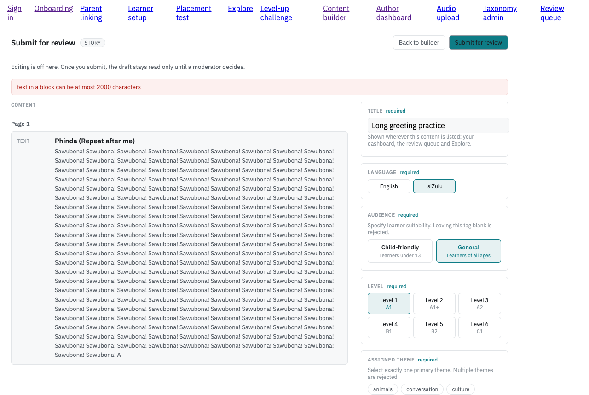

*Submitting a never-saved draft with 2001 characters: the same reason.*


*Submitting a saved draft with 2001 characters: the same reason.*

## CB-GUI-22

### Reopened drafts and starting new ones

**Checks:** A saved draft can be opened from the dashboard, opening one does not leak into the next new draft, and the address always names the draft on screen.

**Before:** CB-GUI-10 done: draft **Greetings in isiZulu** is saved as `<id>`. Browser DevTools open on the Network tab.

| Step | Do this | Expected result | Observed result |
|---|---|---|---|
| 1 | Click **Author dashboard** in the top bar, then **Edit** on the **Greetings in isiZulu** draft. | The address becomes `/content-builder/<id>` and the builder shows that draft. | Pass. As expected (`<id>` was 18). |
| 2 | Click **Author dashboard**, then **+ New content**. | The address is `/content-builder` and a new empty draft opens: empty title, **0 blocks**. | Pass. The address is `/content-builder` (the `?new=1` is dropped) and the draft is empty: **Untitled draft**, **0 blocks**, **All changes saved**. (Before the fix the old draft stayed on screen.) |
| 3 | On that screen add a text block **Umbhalo omusha (A new lesson)** / **Meant for a brand new draft.**, click **Pages**, then **Save**. | **POST /api/content/createContent → 201**: a new draft is created, and the address becomes `/content-builder/<new id>`. The draft from step 1 is not changed. | Pass. **POST /api/content/createContent → 201** and the address became `/content-builder/19`. In the console `await api('getContent/18')` still shows only the one block **Sawubona (Hello)**. (Before the fix this was a **PUT** into the old draft.) |
| 4 | Click **Author dashboard**, then **Content builder** in the top bar. | The builder shows the draft in progress from step 3 (**Umbhalo omusha (A new lesson)**) and the address is `/content-builder/<new id>`. | Pass. As expected: `/content-builder/19` with that block. (Also checked: a draft that has not been saved yet keeps its unsaved block and **Unsaved changes** through the same two clicks, at `/content-builder`.) |
| 5 | Open `/content-builder` in the address bar for a new draft. Add a text block **Sawubona (Hello)** / **Sawubona.**, click **Pages**, **Save**, then **Submit for review** without touching the Audience card. | **Audience chosen** fails until the author picks an audience, as it does for a draft that was never saved (CB-GUI-11, CB-GUI-12 step 4). | **Known limitation (team decision).** **General** is already highlighted and **Audience chosen** passes. The database stores audience only as a child-friendly yes/no, with no "not chosen" value, so the builder reads "no" back as General. The same happens for every draft opened from `/content-builder/<id>`. Not changed in the follow-up. **Back to builder** from here returns to `/content-builder/<id>`. |
| 6 | Save a new draft, open it at `/content-builder/<id>`, click **Delete draft**, **OK**, then reload the page. | After deleting, the address goes back to `/content-builder` (as **Start a new draft** does), so the reload opens a new empty draft. | Pass. **DELETE /api/content/deleteContent/<id> → 200** and the address changed to `/content-builder`. The reload opened a new empty draft (**Page 1**, **0 blocks**, no error). (Before the fix the address kept the deleted id and the reload showed **Error loading your draft**.) |


*+ New content after opening a draft: a new, empty draft.*

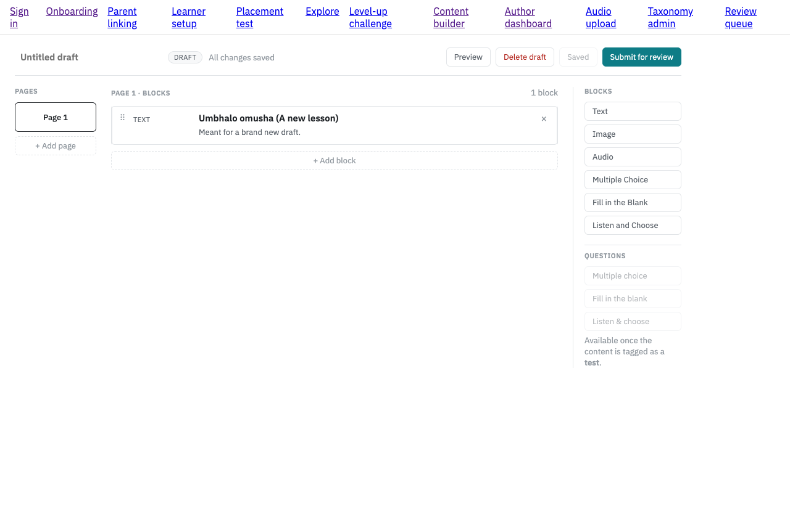

*The top-bar Content builder link returns to the draft in progress (address /content-builder/&lt;new id&gt;).*

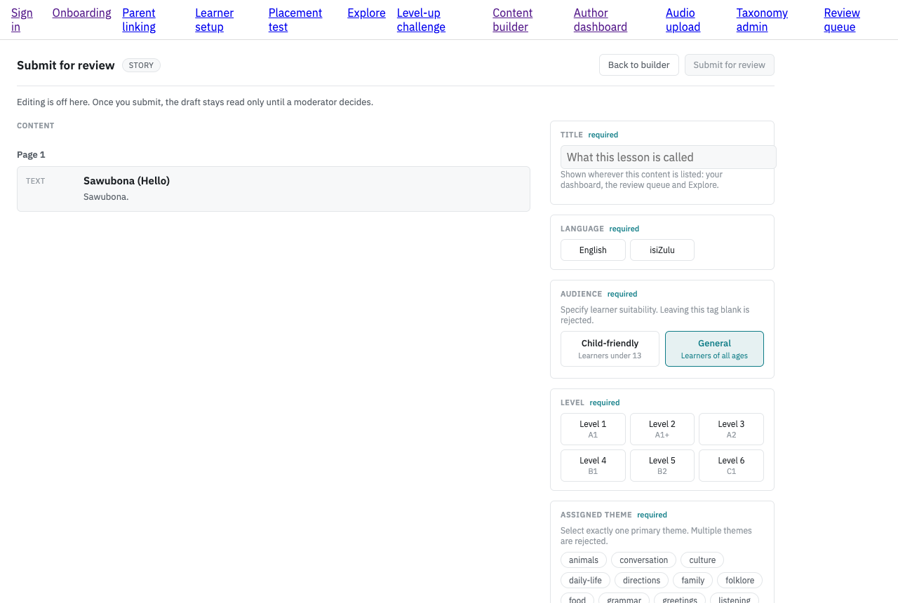

*After one save, General is already chosen without the author picking it.*

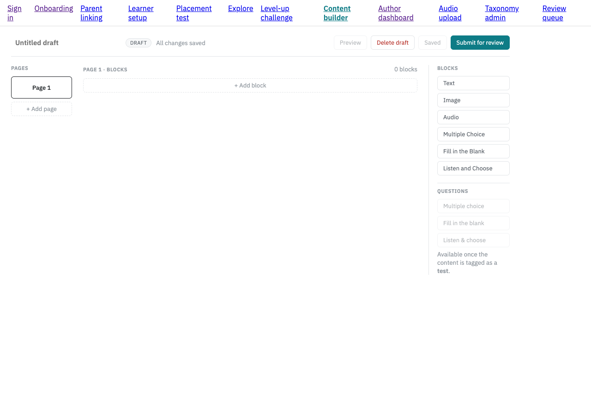

*Reloading after deleting a draft that was opened by its address: a new, empty draft.*

## Findings

Failures, gaps and limitations found, with the test that shows each one:

1. **Size limit reason not shown** (CB-GUI-21). **Fixed in the follow-up commit.** When the server refuses a save or submit with a 4xx, the screen now shows its reason (e.g. **text in a block can be at most 2000 characters**). A server that is down still shows the generic **Error saving this draft** (CB-GUI-15).
2. **The last opened draft stayed open for "new" content** (CB-GUI-22 steps 2–4). **Fixed in the follow-up commit.** **+ New content** now starts an empty draft. A saved draft's id is always in the address, so **Save** only writes to the draft the address names.
3. **Saving picks an audience for the author** (CB-GUI-22 step 5). **Known limitation (team decision).** A saved or reopened draft always comes back with **General** selected, so the **Audience chosen** check can't catch a draft whose author never chose. The database stores audience as a child-friendly yes/no, with no "not chosen" value.
4. **Deleting a reopened draft left its address** (CB-GUI-22 step 6). **Fixed in the follow-up commit.** Deleting now takes the id out of the address, and a reload opens a new empty draft.
5. **Preview can't show questions** (CB-GUI-20, Known gap). The learner reader shows **No renderer yet for block type: …** for Multiple Choice, Fill in the Blank and Listen and Choose.

Smaller things seen during the run, not counted as failures:

- The palette still has the old **Questions** section with three disabled buttons and *Available once the content is tagged as a test.*, directly under the enabled Multiple Choice, Fill in the Blank and Listen and Choose buttons (CB-GUI-01).
- After an upload the builder shows the server's stored file name (a random id), not the name of the file the author chose (CB-GUI-06, CB-GUI-18).
- On the submit screen the Title box sticks out a few pixels past the right edge of its card (visible in CB-GUI-11 and CB-GUI-22 screenshots).

## Not covered yet

- **Image upload.** Image links are still placeholders; nothing is uploaded or shown (CB-GUI-05).
- **Learner view of questions.** Covered only as far as the preview shows (CB-GUI-20).
- **Moderator decisions.** Approving or rejecting, and editing rejected content, belong to the review slice's tests.
- **Other authors' content.** That one author can't open or change another's drafts is checked by the backend API tests, not here.
